# Catalog

Generated by `pnpm run index`. Do not edit by hand.

| Preview | Component | Summary | Use when | Avoid when | Status |
| --- | --- | --- | --- | --- | --- |
|  | [Button](../components/actions/button) | The standard shadcn button with variants and sizes. | Any general action; You want the app's default button | Navigating to another page, where a link is the right element | stable |
|  | [Button Group](../components/actions/button-group) | Joins related buttons into one connected control. | Related actions belong together; A toolbar has few options, such as previous and next | Unrelated actions, which should stay separate | stable |
|  | [Dropdown Menu](../components/actions/dropdown-menu) | A button that opens a list of actions, with groups and shortcuts. | Extra actions don't need permanent space; A row or page has an overflow menu | Choosing a form value, where a select or combobox fits better | stable |
|  | [Magnetic Button](../components/actions/magnetic-button) | A button that gently follows a mouse cursor while hovered. | A landing page has one main call to action; A small moment of motion suits the page | Dense forms or toolbars with neighboring controls; The audience is mostly on touch devices, where the effect doesn't appear | experimental |
| 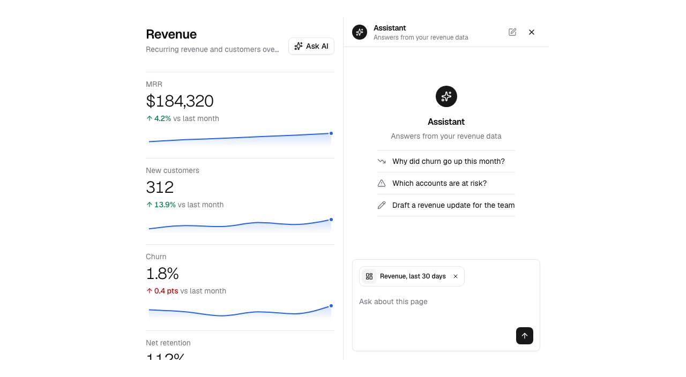 | [AI Assistant: Side Panel](../components/ai-chat/ai-assistant-01) | An assistant docked beside the page, with suggested prompts, the page as context, and New conversation and Close buttons. | An assistant panel or conversation inside a dashboard | A standalone chat app, where the AI Chat block's parts fit | stable |
| 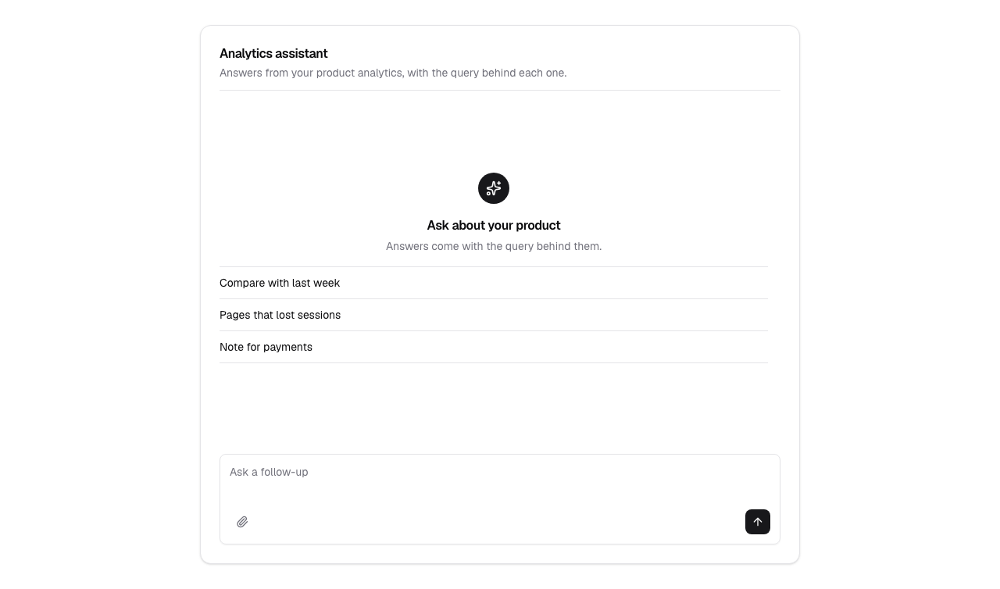 | [AI Assistant: Conversation](../components/ai-chat/ai-assistant-02) | A conversation with a table and a SQL query, where you can attach a file, copy, rate or regenerate a reply, or pick a follow-up question. | An assistant panel or conversation inside a dashboard | A standalone chat app, where the AI Chat block's parts fit | stable |
| 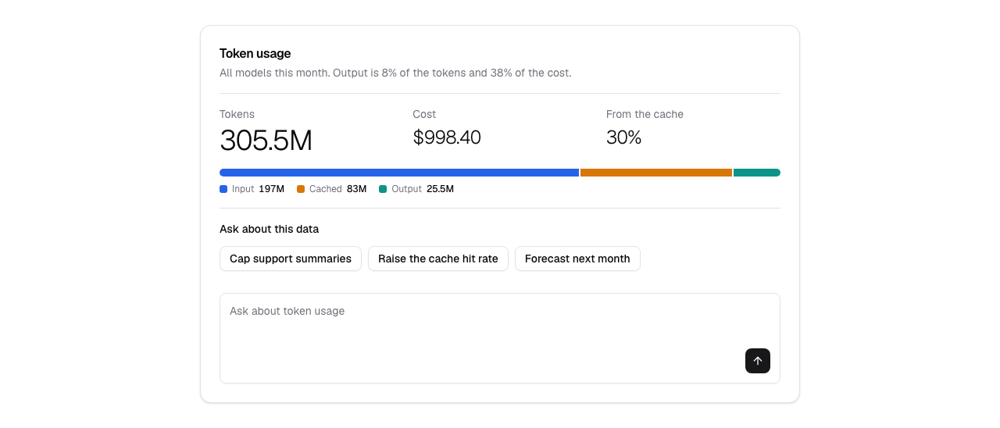 | [AI Assistant: Ask About Data](../components/ai-chat/ai-assistant-03) | Questions about this month's [AI Usage](/docs/blocks/ai-usage) numbers, with the tokens and cost of each answer and a change that waits for your approval. | An assistant panel or conversation inside a dashboard | A standalone chat app, where the AI Chat block's parts fit | stable |
| 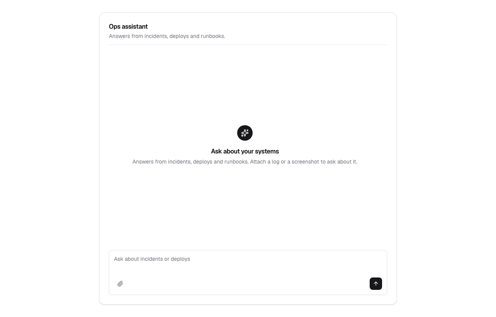 | [AI Assistant: Retry](../components/ai-chat/ai-assistant-04) | A reply that failed, kept in the conversation with a button to try again. | An assistant panel or conversation inside a dashboard | A standalone chat app, where the AI Chat block's parts fit | stable |
|  | [Call Chip](../components/ai-chat/call-chip) | A compact row showing one agent tool call, such as a search, with its icon, argument, progress and result. | An agent's tool calls should be visible while they run; A list of steps needs running, done and failed states | The step's progress isn't meaningful to the user; You need a general-purpose tag or badge | stable |
|  | [Chain of Thought](../components/ai-chat/chain-of-thought) | A collapsible list of an AI's reasoning steps, with search results and images. | Showing the steps behind an AI answer; People want to check how a result was reached | A simple waiting state is enough | stable |
|  | [Context Usage](../components/ai-chat/context) | A small ring showing how much of an AI model's context is used, with a hover card of token details. | People should see how full a conversation's context is; You report token use or cost | People don't choose models or manage context; Touch-first screens, where hover isn't available | stable |
| 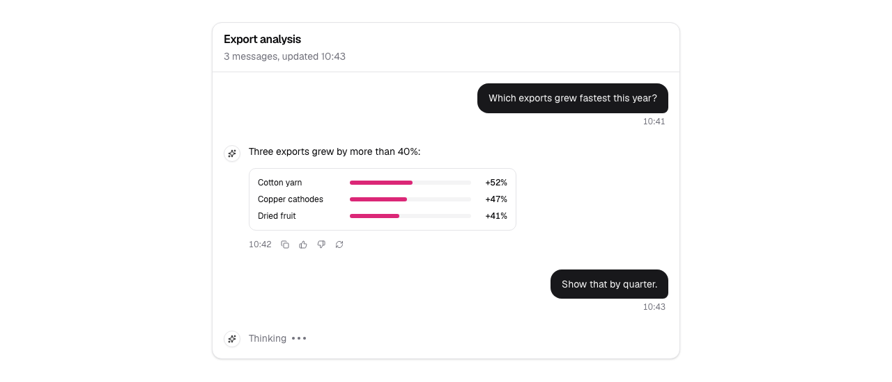 | [Conversation](../components/ai-chat/conversation) | The turns of an AI chat with avatars, copy and regenerate actions, failed replies and a thinking state, built on the messaging Message and Bubble parts. | Showing an AI assistant conversation; Replies need copy, regenerate or retry actions | A conversation between people, where messaging/message fits directly | stable |
|  | [Lattice Loader](../components/ai-chat/lattice-loader) | A small animated dot grid that shows waiting, then morphs into a tick or a cross, with an optional label and timer. | Showing that an agent or search is working for an unknown time; A compact status needs to end in success or failure | You know the real progress and should show a percentage; A whole page is loading and a skeleton would show its layout | stable |
|  | [Prompt Bar](../components/ai-chat/prompt-bar) | An AI chat input with a level selector, sparks at the top level, a morphing send button, rotating placeholders, and optional sources, commands, models and dictation. | An AI chat or agent needs its main input; Users choose how much effort or depth the AI should use | A plain search box or short form field is enough; The app needs rich text editing | stable |
|  | [Task](../components/ai-chat/task) | A collapsible task with its sub-steps and the files it touched. | An agent works through a named job; Sub-steps and files should be available on demand | The steps carry no useful information for people | stable |
| 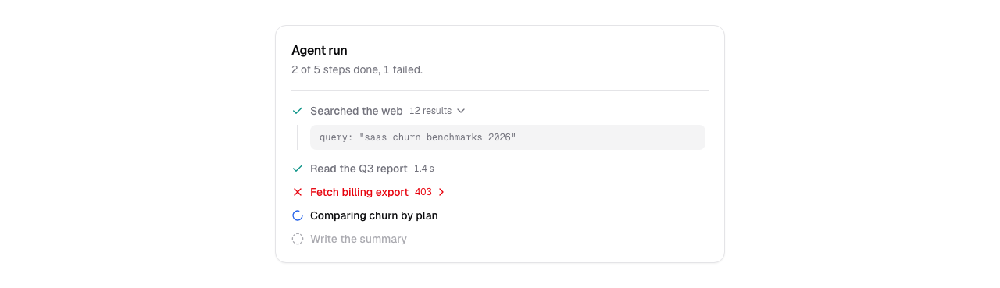 | [Trace](../components/ai-chat/trace) | Compact lines of an agent's activity, with status and collapsible detail. | Logging an agent's actions inside a chat; Many small steps need a quiet, compact display | Each step deserves its own rich card | stable |
| 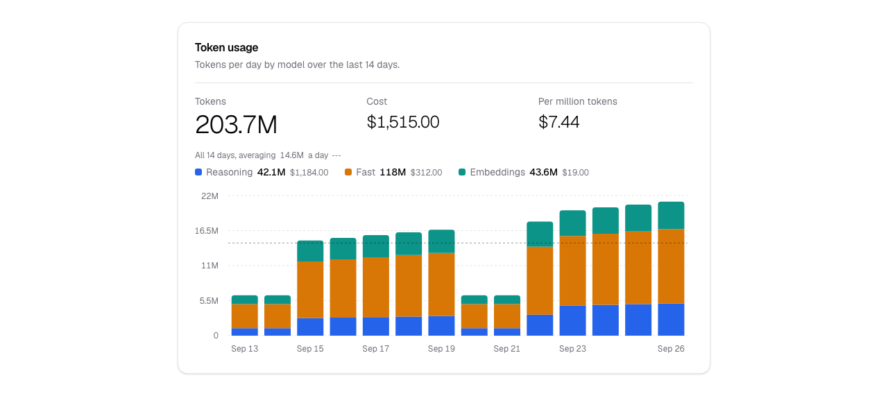 | [AI Usage: Token Usage](../components/analytics/ai-usage-01) | Tokens per day stacked by model against the daily average, with the total cost and the cost per million tokens. | Showing tokens, cost and model performance | The product doesn't call AI models | stable |
| 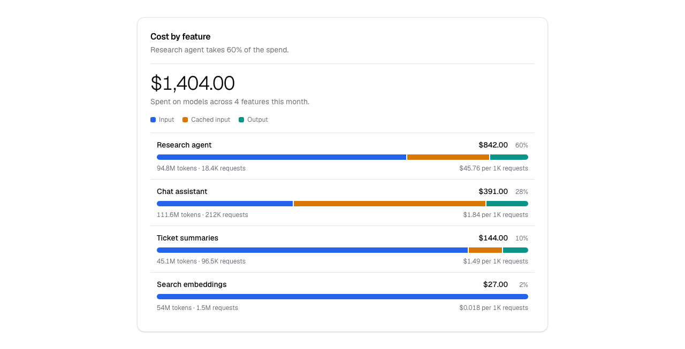 | [AI Usage: Cost by Feature](../components/analytics/ai-usage-02) | Model spend by product feature, with each feature's input, cached and output tokens and its cost per thousand requests. | Showing tokens, cost and model performance | The product doesn't call AI models | stable |
| 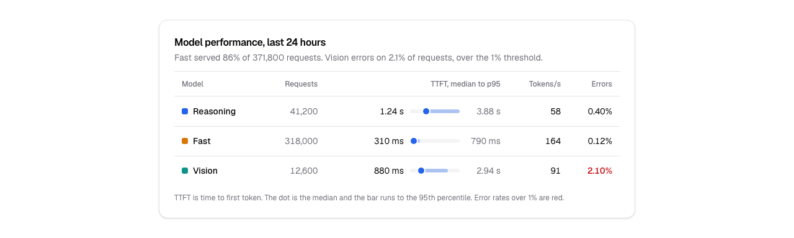 | [AI Usage: Model Performance](../components/analytics/ai-usage-03) | Requests, time to first token from the median to the 95th percentile, output speed and error rate for each model. | Showing tokens, cost and model performance | The product doesn't call AI models | stable |
| 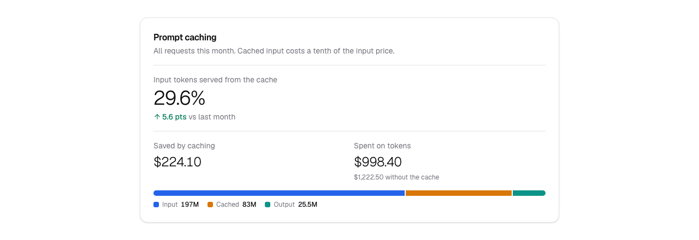 | [AI Usage: Prompt Caching](../components/analytics/ai-usage-04) | The share of input tokens served from the cache, its change, what it saved and what tokens would have cost without it. | Showing tokens, cost and model performance | The product doesn't call AI models | stable |
| 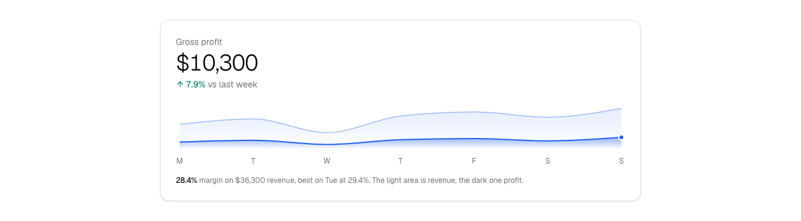 | [KPI: Area Chart](../components/analytics/area-chart-kpi-01) | Gross profit with its margin, profit drawn inside revenue by day, and the day with the best margin. | A dashboard needs headline numbers with their change; One number should be read at a glance | People need the full series, where a chart panel fits better | stable |
| 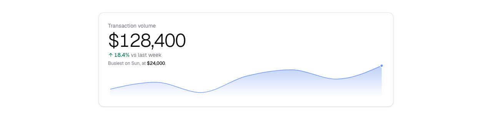 | [KPI: Background Chart](../components/analytics/area-chart-kpi-02) | A large total with an area chart along the bottom, for the hero number at the top of a dashboard. | A dashboard needs headline numbers with their change; One number should be read at a glance | People need the full series, where a chart panel fits better | stable |
| 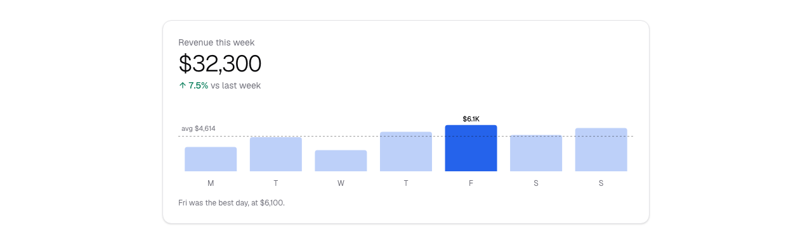 | [KPI: Bar Chart](../components/analytics/bar-chart-kpi-01) | The week's total with a bar for each day and the change on the week before. | A dashboard needs headline numbers with their change; One number should be read at a glance | People need the full series, where a chart panel fits better | stable |
| 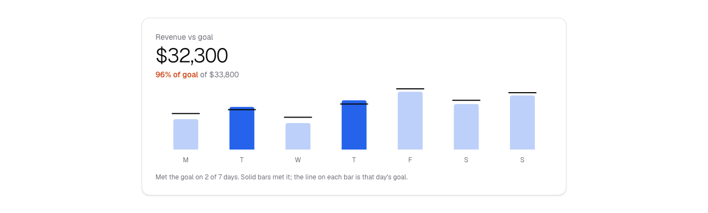 | [KPI: Actual vs Goal](../components/analytics/bar-chart-kpi-02) | Each day's value with its goal marked on the bar, and the days that met it solid. | A dashboard needs headline numbers with their change; One number should be read at a glance | People need the full series, where a chart panel fits better | stable |
| 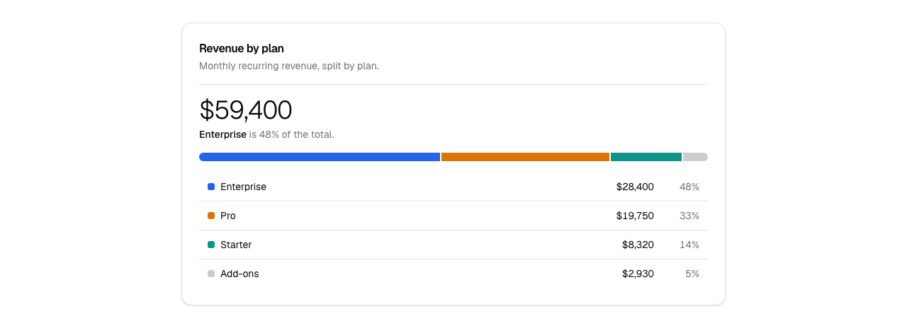 | [Breakdown: Segmented Bar](../components/analytics/breakdown-01) | A single 100% bar with each category's value and share listed below. | Showing how a total splits into categories | Categories change over time, where a stacked chart fits better | stable |
| 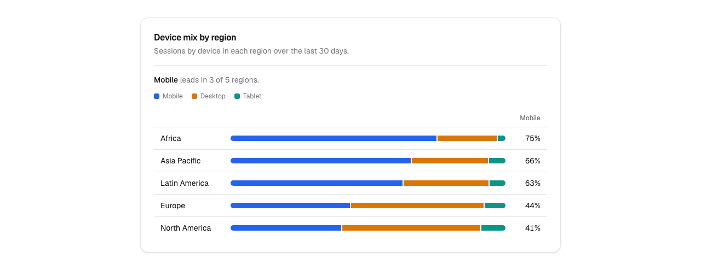 | [Breakdown: Composition by Group](../components/analytics/breakdown-02) | The mix across groups, sorted by one category's share, which is labelled on every row. | Showing how a total splits into categories | Categories change over time, where a stacked chart fits better | stable |
| 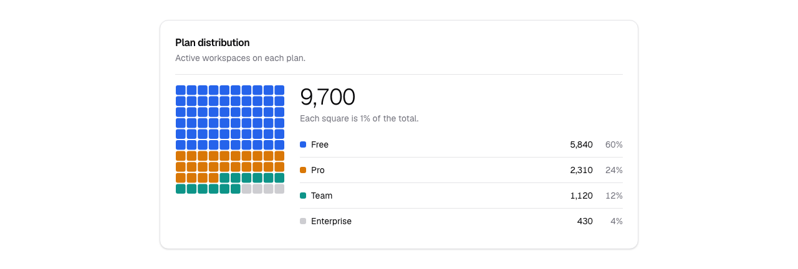 | [Breakdown: Waffle](../components/analytics/breakdown-03) | A 10×10 grid where each square is 1% of the total. | Showing how a total splits into categories | Categories change over time, where a stacked chart fits better | stable |
| 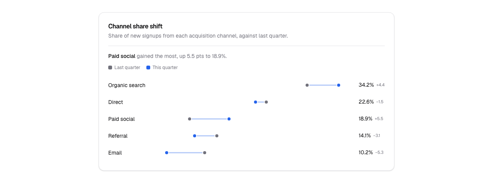 | [Breakdown: Share Shift](../components/analytics/breakdown-04) | How each category's share moved between two periods, as two dots joined by a line. | Showing how a total splits into categories | Categories change over time, where a stacked chart fits better | stable |
| 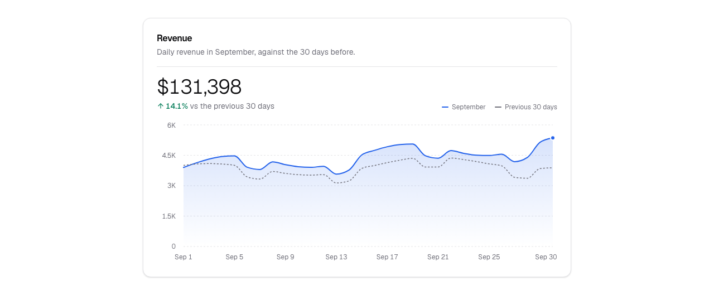 | [Chart Panel: Period Comparison](../components/analytics/chart-panel-01) | This period as an area against the previous one as a dashed line, with the change written as a sentence. | A full-size chart with a headline figure and the change written out; People compare a period with the one before | A tiny inline trend is enough, where a KPI sparkline fits | stable |
| 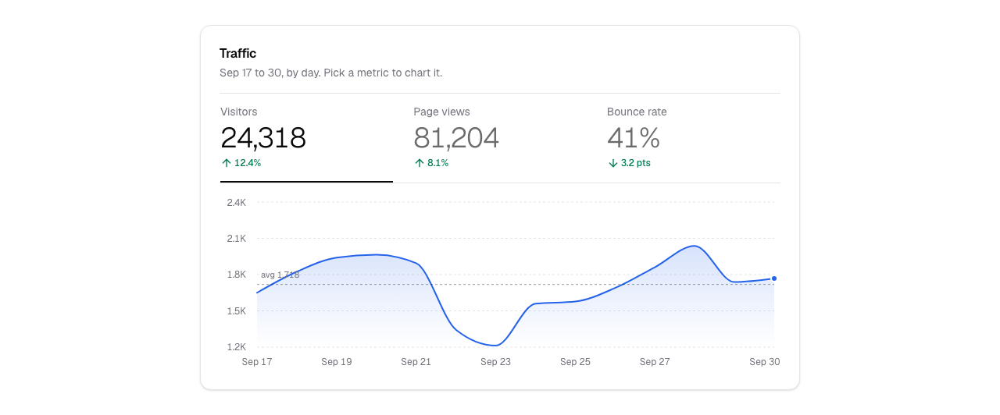 | [Chart Panel: Metric Tabs](../components/analytics/chart-panel-02) | Related metrics as tabs, each with its total and change, and the chosen metric's average marked on the chart. | A full-size chart with a headline figure and the change written out; People compare a period with the one before | A tiny inline trend is enough, where a KPI sparkline fits | stable |
| 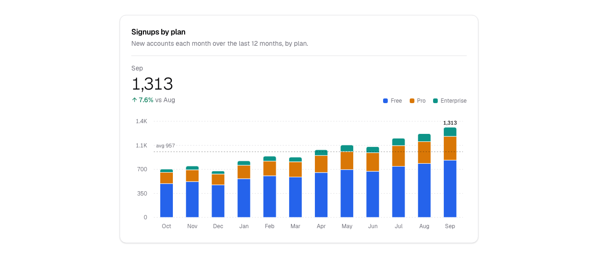 | [Chart Panel: Stacked Bars](../components/analytics/chart-panel-03) | Monthly totals split by category, with the average marked and the latest total labelled. | A full-size chart with a headline figure and the change written out; People compare a period with the one before | A tiny inline trend is enough, where a KPI sparkline fits | stable |
| 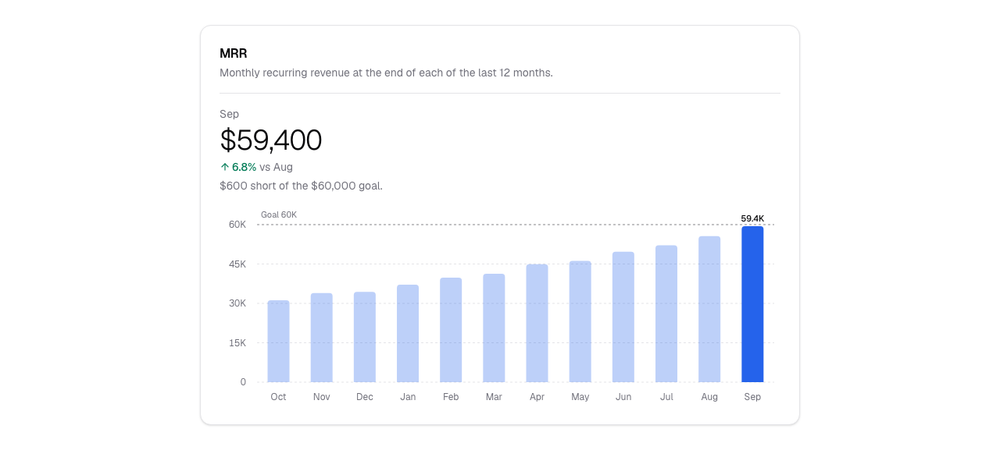 | [Chart Panel: Highlighted Bar](../components/analytics/chart-panel-04) | A single series with the latest period highlighted against a goal line, and how far off the goal it is. | A full-size chart with a headline figure and the change written out; People compare a period with the one before | A tiny inline trend is enough, where a KPI sparkline fits | stable |
| 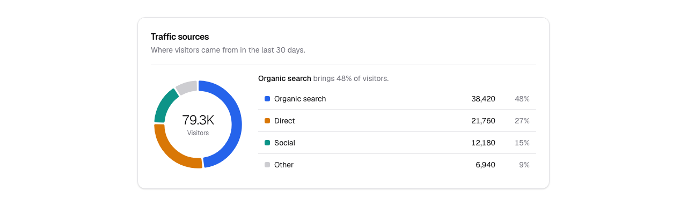 | [Chart Panel: Breakdown Donut](../components/analytics/chart-panel-05) | Part-to-whole at a glance, with values and shares listed beside the donut. | A full-size chart with a headline figure and the change written out; People compare a period with the one before | A tiny inline trend is enough, where a KPI sparkline fits | stable |
| 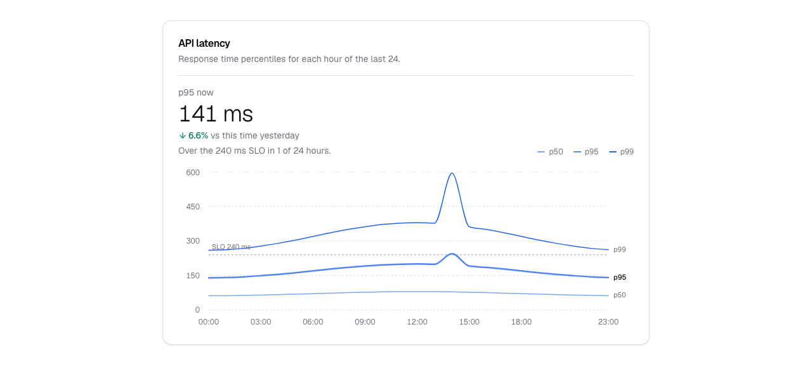 | [Chart Panel: Percentiles](../components/analytics/chart-panel-06) | Percentile lines in one hue from light to full strength, against an SLO line and how many hours went over it. | A full-size chart with a headline figure and the change written out; People compare a period with the one before | A tiny inline trend is enough, where a KPI sparkline fits | stable |
| 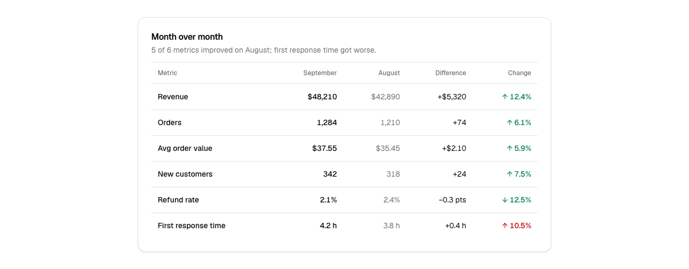 | [Comparison: Period over Period](../components/analytics/comparison-01) | Each metric this period and last, with the difference and the change, under a sentence saying how many improved. | Comparing periods, variants or segments | Only one value exists | stable |
| 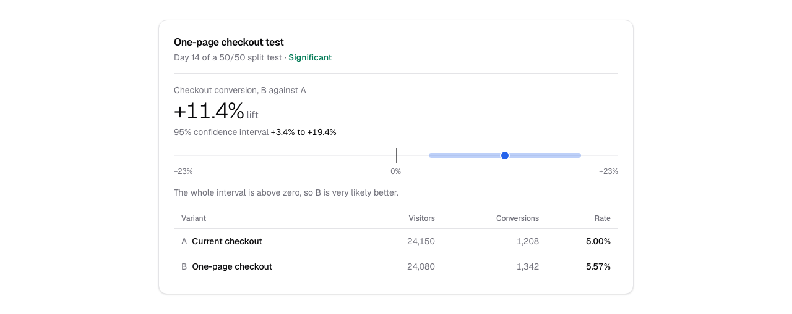 | [Comparison: A/B Test](../components/analytics/comparison-02) | Lift for a variant over the control, with a 95% confidence interval drawn against zero and a sentence on what it means. | Comparing periods, variants or segments | Only one value exists | stable |
| 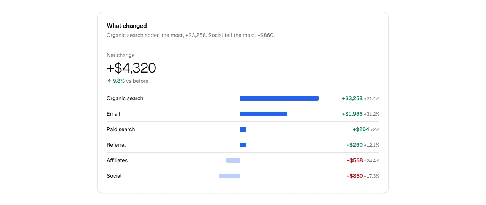 | [Comparison: What Changed](../components/analytics/comparison-03) | The net change, then the change in each segment as bars either side of zero, from the biggest gain to the biggest drop. | Comparing periods, variants or segments | Only one value exists | stable |
| 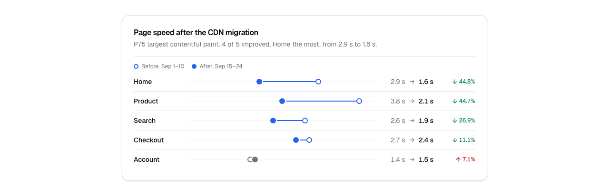 | [Comparison: Before and After](../components/analytics/comparison-04) | Two values per row on a shared scale, with a hollow dot for before and a filled dot for after. | Comparing periods, variants or segments | Only one value exists | stable |
| 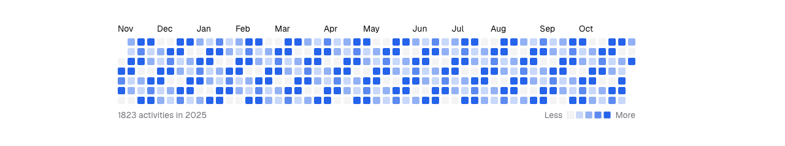 | [Contribution Graph](../components/analytics/contribution-graph) | A year-long activity heatmap with month labels, a total count and a legend. | Showing daily activity over a long period; Consistency over time is the main story | People need exact daily values at a glance; Narrow screens without horizontal scrolling; A year of activity as a dashboard block, where analytics/heatmap-03 fits better | stable |
| 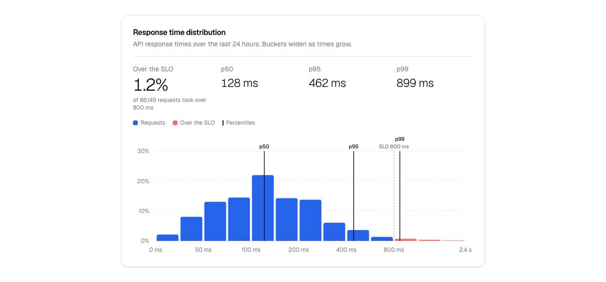 | [Distribution: Histogram](../components/analytics/distribution-01) | Response times in buckets with p50, p95 and p99 lines, and the share over the SLO in red. | The shape of a metric matters, such as latency percentiles | Only the average is useful | stable |
| 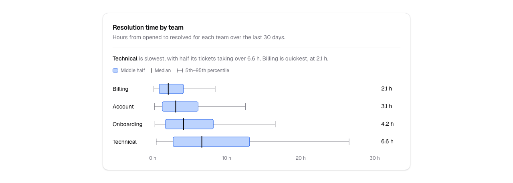 | [Distribution: Box Plots](../components/analytics/distribution-02) | One box and whiskers per group on a shared axis, from the 5th to the 95th percentile. | The shape of a metric matters, such as latency percentiles | Only the average is useful | stable |
| 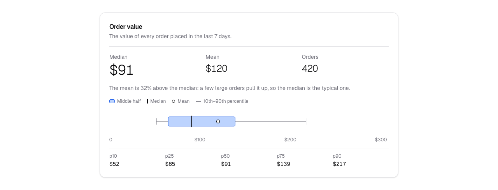 | [Distribution: Spread](../components/analytics/distribution-03) | The median, mean and percentiles of raw values, with a note when a long tail pulls the mean away from the median. | The shape of a metric matters, such as latency percentiles | Only the average is useful | stable |
| 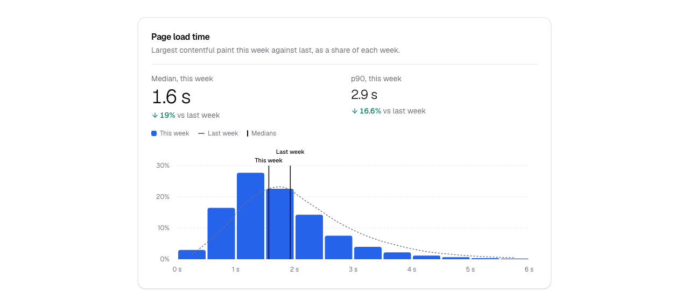 | [Distribution: Before and After](../components/analytics/distribution-04) | This week's distribution against last week's, with both medians and the change at the median and p90. | The shape of a metric matters, such as latency percentiles | Only the average is useful | stable |
| 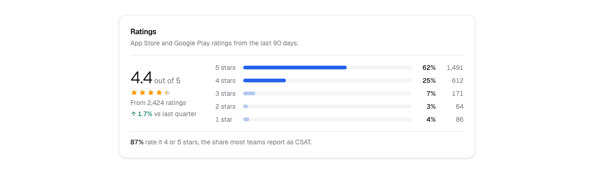 | [Feedback: Ratings](../components/analytics/feedback-01) | The average rating with stars, the number of ratings and the share of each star, with CSAT and the change on the last period. | Ratings, reviews and satisfaction over time | No customer feedback is collected | stable |
| 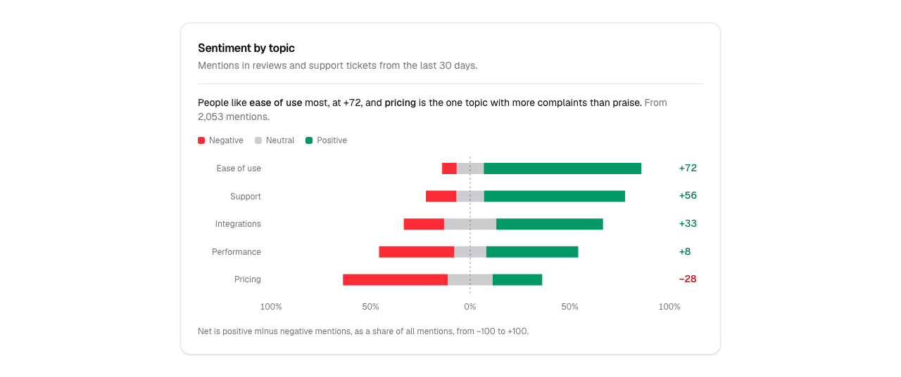 | [Feedback: Sentiment by Topic](../components/analytics/feedback-02) | Negative and positive mentions either side of a centre line for each topic, sorted by net sentiment. | Ratings, reviews and satisfaction over time | No customer feedback is collected | stable |
| 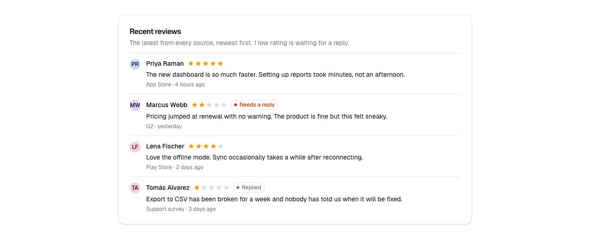 | [Feedback: Recent Reviews](../components/analytics/feedback-03) | The latest reviews with their rating and source, and whether low ratings still need a reply. | Ratings, reviews and satisfaction over time | No customer feedback is collected | stable |
| 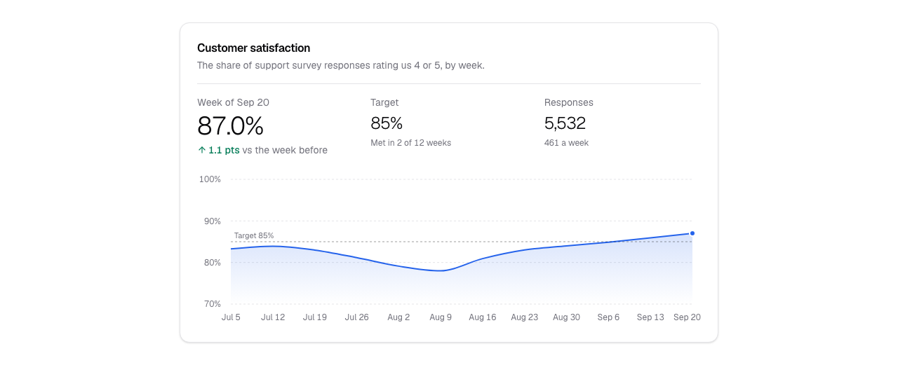 | [Feedback: Customer Satisfaction](../components/analytics/feedback-04) | Weekly CSAT against a target line, with the change on the week before and how many weeks met the target. | Ratings, reviews and satisfaction over time | No customer feedback is collected | stable |
| 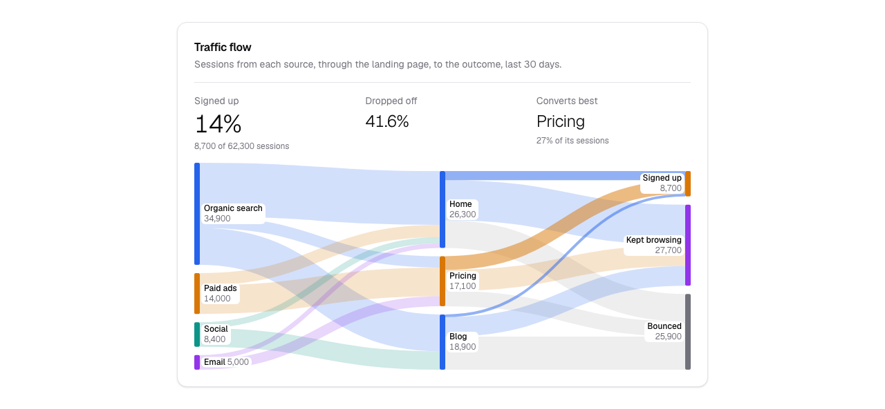 | [Flow: Traffic Flow](../components/analytics/flow-01) | Sessions from each source, through the landing page, to signing up, browsing on or bouncing, with the page that converts best named. | Showing how a total moves between stages, such as traffic sources to outcomes | Fewer than three stages, where a breakdown is simpler | stable |
| 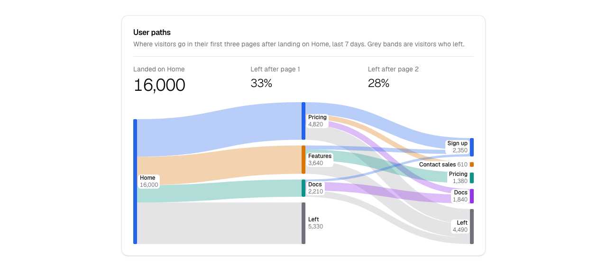 | [Flow: User Paths](../components/analytics/flow-02) | Where visitors go in their first pages after landing, with the ones who left at each step. | Showing how a total moves between stages, such as traffic sources to outcomes | Fewer than three stages, where a breakdown is simpler | stable |
| 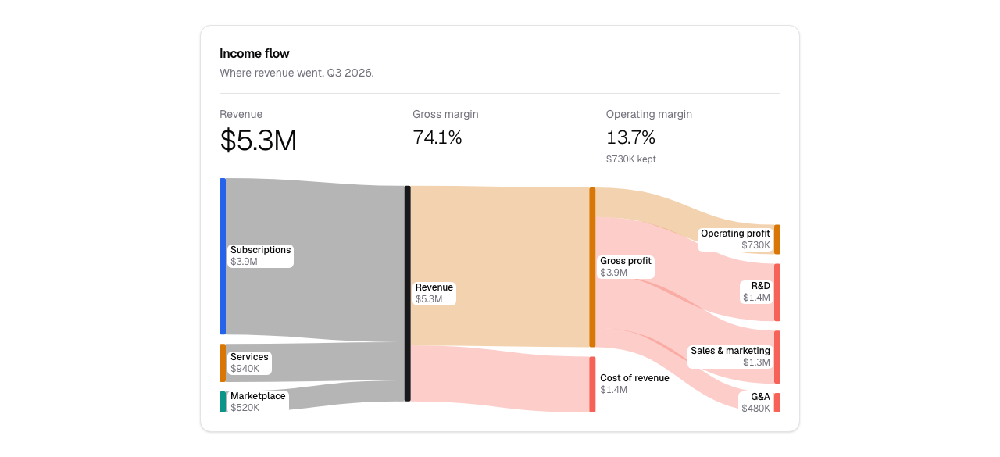 | [Flow: Income Flow](../components/analytics/flow-03) | Revenue streams into revenue, then out to costs and profit, with each part's share of revenue. | Showing how a total moves between stages, such as traffic sources to outcomes | Fewer than three stages, where a breakdown is simpler | stable |
| 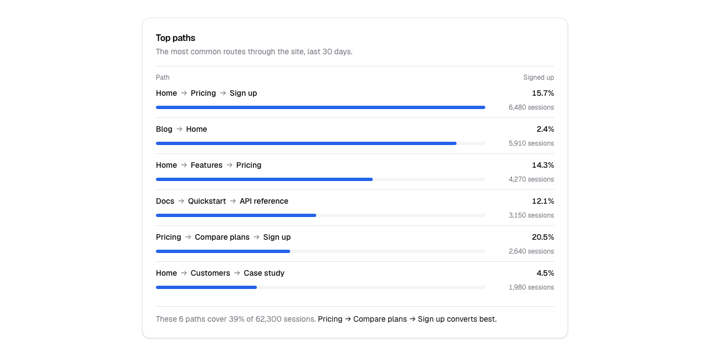 | [Flow: Top Paths](../components/analytics/flow-04) | The most common routes as steps, ranked by how many took them, with how often each reaches the goal. | Showing how a total moves between stages, such as traffic sources to outcomes | Fewer than three stages, where a breakdown is simpler | stable |
| 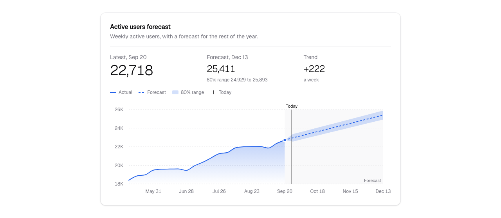 | [Forecast: Actual and Forecast](../components/analytics/forecast-01) | Weekly actuals continuing into a dashed forecast with a shaded 80% range and a today marker. | Projecting actuals to a target or date | Data is too sparse to project | stable |
| 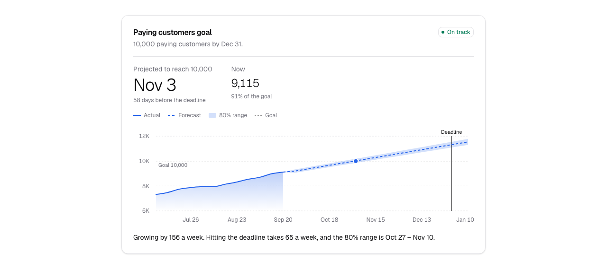 | [Forecast: Date to Target](../components/analytics/forecast-02) | The running total heading for a goal line, with the date the forecast reaches it and what each week needs to make the deadline. | Projecting actuals to a target or date | Data is too sparse to project | stable |
| 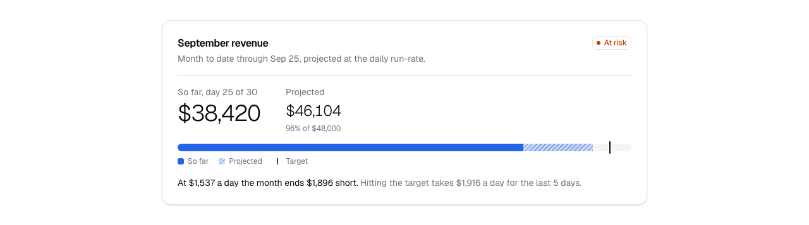 | [Forecast: Run-Rate](../components/analytics/forecast-03) | Month to date, projected to the end of the month at the daily run-rate, with what's needed per day to hit the target. | Projecting actuals to a target or date | Data is too sparse to project | stable |
| 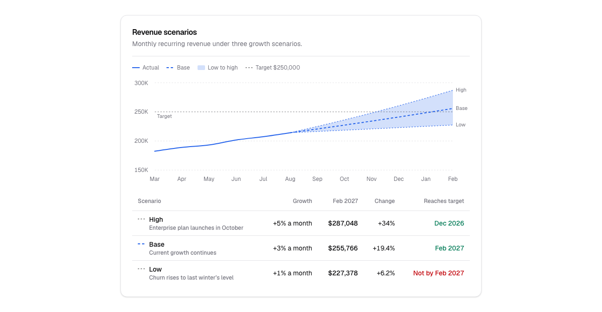 | [Forecast: Scenarios](../components/analytics/forecast-04) | Low, base and high growth scenarios from the last actual, as a chart and a table with when each one reaches the target. | Projecting actuals to a target or date | Data is too sparse to project | stable |
| 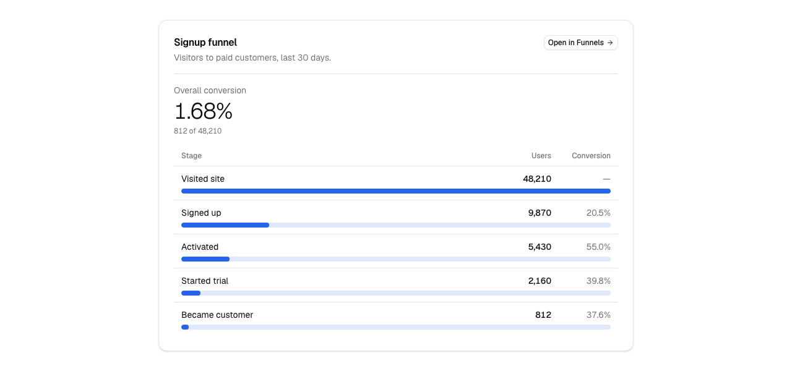 | [Funnel: Stage Bars](../components/analytics/funnel-01) | Overall conversion, then each stage as a bar sized against the first, with its step conversion. | Showing conversion between steps and where people drop off | Steps don't happen in order | stable |
| 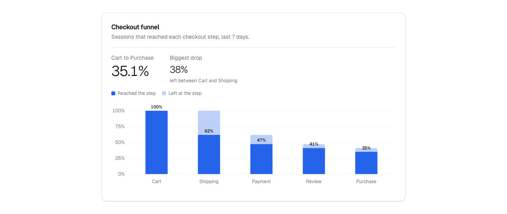 | [Funnel: Columns](../components/analytics/funnel-02) | Each stage as a column on a 0 to 100% axis, topped by the share that left at that step, with the biggest drop named. | Showing conversion between steps and where people drop off | Steps don't happen in order | stable |
| 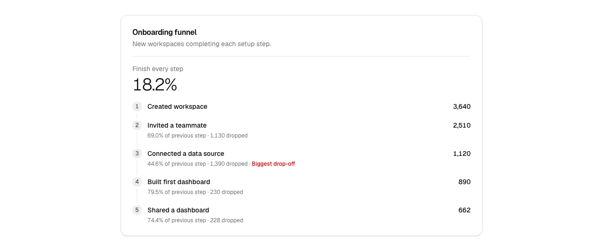 | [Funnel: Steps](../components/analytics/funnel-03) | A vertical stepper that names the step with the biggest drop-off. | Showing conversion between steps and where people drop off | Steps don't happen in order | stable |
| 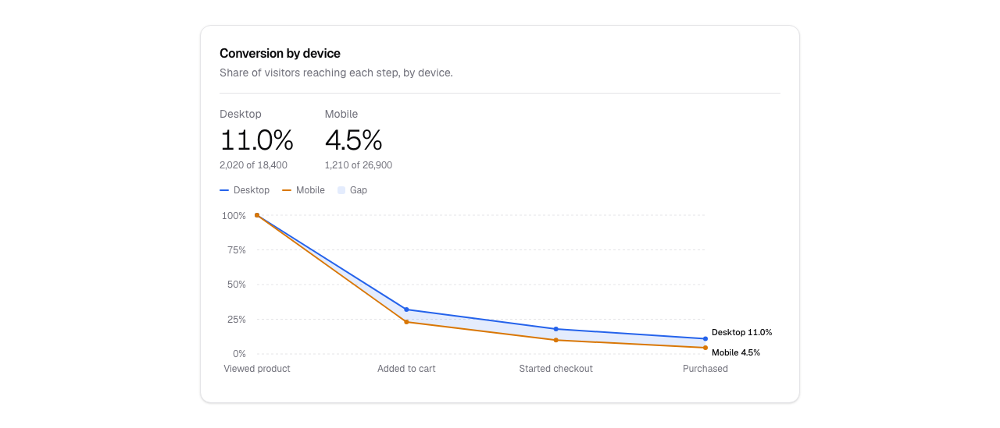 | [Funnel: Segment Comparison](../components/analytics/funnel-04) | Two segments as lines through every stage, each as a share of its first step, with the gap between them shaded. | Showing conversion between steps and where people drop off | Steps don't happen in order | stable |
| 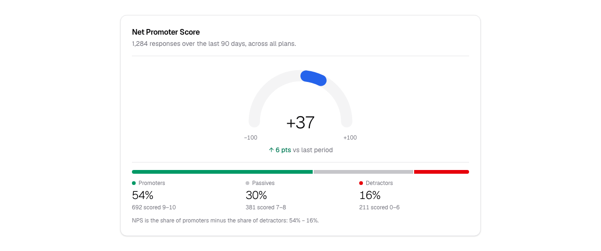 | [Gauge: Net Promoter Score](../components/analytics/gauge-01) | NPS on its full −100 to 100 scale, with the change since last period and the split of promoters, passives and detractors. | One number on a known scale with bands or a target | The scale has no meaningful bounds | stable |
|  | [Gauge: Health Score](../components/analytics/gauge-02) | An account health score marked on poor, fair and good bands, with the factors that pull it down most. | One number on a known scale with bands or a target | The scale has no meaningful bounds | stable |
|  | [Gauge: System Load](../components/analytics/gauge-03) | CPU, memory and disk as small gauges, each with its warning and critical thresholds. | One number on a known scale with bands or a target | The scale has no meaningful bounds | stable |
|  | [Gauge: Score Card](../components/analytics/gauge-04) | A satisfaction score with a target tick on the arc, the change since last period and the points left to the target. | One number on a known scale with bands or a target | The scale has no meaningful bounds | stable |
|  | [Geo: State Tile Map](../components/analytics/geo-01) | Revenue by state on a single-hue scale, with the total and the top five states as ranked bars. | Breaking a value down by country, state or city | Geography isn't meaningful to the metric | stable |
|  | [Geo: Top Countries](../components/analytics/geo-02) | The leading countries with flags, values and shares, and the rest summed into one row. | Breaking a value down by country, state or city | Geography isn't meaningful to the metric | stable |
|  | [Geo: Dotted World Map](../components/analytics/geo-03) | Active users by city right now, with markers sized by value and the busiest city named on the map. | Breaking a value down by country, state or city | Geography isn't meaningful to the metric | stable |
|  | [Geo: Region Split](../components/analytics/geo-04) | Revenue split across regions, each with its share and change on the previous quarter. | Breaking a value down by country, state or city | Geography isn't meaningful to the metric | stable |
|  | [Goals: Target](../components/analytics/goals-01) | One target with where today's pace ends up and how much a day is left to do. | Tracking progress to a target with pace against the period | There is no target to compare with | stable |
|  | [Goals: Goal List](../components/analytics/goals-02) | Several goals for the same period, each with its own pace. | Tracking progress to a target with pace against the period | There is no target to compare with | stable |
|  | [Goals: Projection](../components/analytics/goals-03) | Cumulative progress this month, projected to the end of the month, with the day it reaches the target or how far short it ends. | Tracking progress to a target with pace against the period | There is no target to compare with | stable |
|  | [Goals: Daily Rings](../components/analytics/goals-04) | Small daily goals as rings, each saying how many are left or how far past the goal it went. | Tracking progress to a target with pace against the period | There is no target to compare with; One count against a goal with the daily pace, where analytics/progress-kpi-03 fits better | stable |
|  | [Heatmap: Weekday by Hour](../components/analytics/heatmap-01) | When visitors arrive, by day of the week and hour of the day, with each hour's total in bars above the grid. | A value across two dimensions, such as weekday by hour | One dimension is enough, where a bar chart fits | stable |
|  | [Heatmap: Cohort Retention](../components/analytics/heatmap-02) | The share of each weekly signup cohort still active in each week after signup. | A value across two dimensions, such as weekday by hour | One dimension is enough, where a bar chart fits | stable |
|  | [Heatmap: Calendar](../components/analytics/heatmap-03) | A year of daily values, with the busiest day and the longest run of active days. | A value across two dimensions, such as weekday by hour | One dimension is enough, where a bar chart fits; A GitHub-style contribution graph with a legend and tooltips, where analytics/contribution-graph fits better | stable |
|  | [Heatmap: Hot Spots](../components/analytics/heatmap-04) | p95 latency by endpoint over the last 24 hours, with a dot on each window over the target. | A value across two dimensions, such as weekday by hour | One dimension is enough, where a bar chart fits | stable |
|  | [Insights: Feed](../components/analytics/insights-01) | A list of insights, each with its kind, topic, sentence, an optional line of drivers and a link to explore. | Explaining what data shows in plain language; Calling out anomalies and drivers | You have no explanation text to show | stable |
|  | [Insights: Anomaly Callout](../components/analytics/insights-02) | An unusual reading against the range it was expected to fall in, with the worst day labelled, the explanation and the likely causes. | Explaining what data shows in plain language; Calling out anomalies and drivers | You have no explanation text to show | stable |
|  | [Insights: Key Drivers](../components/analytics/insights-03) | What contributed to a change, as bars either side of zero, under a sentence naming the biggest driver and drag. | Explaining what data shows in plain language; Calling out anomalies and drivers | You have no explanation text to show | stable |
|  | [Insights: Weekly Digest](../components/analytics/insights-04) | A headline, three takeaways and buttons to say whether it helped. | Explaining what data shows in plain language; Calling out anomalies and drivers | You have no explanation text to show | stable |
|  | [KPI: Headline](../components/analytics/kpi-01) | A value with its change and what it's compared with. | A dashboard needs headline numbers with their change; One number should be read at a glance | People need the full series, where a chart panel fits better | stable |
|  | [KPI: Compact](../components/analytics/kpi-02) | A value with its change written beside the label, for a tight grid of KPIs. | A dashboard needs headline numbers with their change; One number should be read at a glance | People need the full series, where a chart panel fits better | stable |
|  | [KPI: Previous Value](../components/analytics/kpi-03) | A rate beside its previous value, with the change in percentage points. | A dashboard needs headline numbers with their change; One number should be read at a glance | People need the full series, where a chart panel fits better | stable |
|  | [KPI: Provenance](../components/analytics/kpi-04) | A value with a button that says how it was computed: what's counted, the dates, the filters, the query and a link to the rows. | A dashboard needs headline numbers with their change; One number should be read at a glance | People need the full series, where a chart panel fits better | stable |
|  | [KPI: Row](../components/analytics/kpi-05) | A row of headline KPIs, each in its own card, for the top of a dashboard. | A dashboard needs headline numbers with their change; One number should be read at a glance | People need the full series, where a chart panel fits better; Several metrics in one card with a shared change period, where analytics/stat-group-01 fits better | stable |
|  | [Leaderboard: Share Bars](../components/analytics/leaderboard-01) | Ranked rows with a bar sized relative to the leader, and how much of the traffic the top page drew. | Ranking pages, products, people or regions | Order doesn't matter | stable |
|  | [Leaderboard: Team Ranking](../components/analytics/leaderboard-02) | People ranked by revenue, each bar running to the person's quota, with the change on the last period. | Ranking pages, products, people or regions | Order doesn't matter | stable |
|  | [Leaderboard: Podium](../components/analytics/leaderboard-03) | The top three on a podium sized by their totals, with the rest of the field listed below. | Ranking pages, products, people or regions | Order doesn't matter | stable |
|  | [Leaderboard: Rank Movement](../components/analytics/leaderboard-04) | Products ranked by revenue, with how many places each moved and the biggest climber named. | Ranking pages, products, people or regions | Order doesn't matter | stable |
|  | [Leaderboard: Sortable](../components/analytics/leaderboard-05) | A ranking you can reverse and expand to show every entry. | Ranking pages, products, people or regions | Order doesn't matter | stable |
|  | [KPI: Line Chart](../components/analytics/line-chart-kpi-01) | This week as a filled area over last week as a dashed line, with the days it fell behind written underneath. | A dashboard needs headline numbers with their change; One number should be read at a glance | People need the full series, where a chart panel fits better | stable |
|  | [Metric List: Sparklines](../components/analytics/metric-list-01) | Metrics with their change and a 14-day sparkline. | Many metrics in one dense list with their change | A handful of metrics, where KPI cards fit | stable |
|  | [Metric List: Sections](../components/analytics/metric-list-02) | Metrics grouped into sections, each with a header and how many of its metrics improved. | Many metrics in one dense list with their change | A handful of metrics, where KPI cards fit | stable |
|  | [Metric List: Targets](../components/analytics/metric-list-03) | Metrics against their targets, floors or ceilings, each with a bar, a tick at the target and a status. | Many metrics in one dense list with their change | A handful of metrics, where KPI cards fit | stable |
|  | [Metric List: Watchlist](../components/analytics/metric-list-04) | A list of metrics beside a chart of the selected one against its 30-day average. | Many metrics in one dense list with their change | A handful of metrics, where KPI cards fit | stable |
|  | [KPI: Target Pace](../components/analytics/progress-kpi-01) | Progress to a monthly target, with where the current pace ends the month and where an even pace would be today. | A dashboard needs headline numbers with their change; One number should be read at a glance | People need the full series, where a chart panel fits better | stable |
|  | [KPI: Status Breakdown](../components/analytics/progress-kpi-02) | The share of work done, as one bar split by status, with a count for each. | A dashboard needs headline numbers with their change; One number should be read at a glance | People need the full series, where a chart panel fits better | stable |
|  | [KPI: Goal Ring](../components/analytics/progress-kpi-03) | A count against a goal as a ring, with how many are left and how many a day that takes. | A dashboard needs headline numbers with their change; One number should be read at a glance | People need the full series, where a chart panel fits better; Several daily goals as rings side by side, where analytics/goals-04 fits better | stable |
|  | [Realtime: Right Now](../components/analytics/realtime-01) | Active users, page views per second over the last minute and the pages with the most people on them. | Data that changes every second, such as active users | Data updates hourly or less | stable |
|  | [Realtime: Throughput](../components/analytics/realtime-02) | Requests per second over the last five minutes, with the peak, the error rate and errors on their own scale. | Data that changes every second, such as active users | Data updates hourly or less | stable |
|  | [Realtime: Live Activity](../components/analytics/realtime-03) | Orders, sign-ups, refunds and messages as they arrive, newest first, with a pause button. | Data that changes every second, such as active users | Data updates hourly or less | stable |
|  | [Realtime: Today So Far](../components/analytics/realtime-04) | Running totals since midnight against yesterday at the same time, with orders per hour beside yesterday's. | Data that changes every second, such as active users | Data updates hourly or less | stable |
|  | [Retention: Cohort Table](../components/analytics/retention-01) | A retention triangle with one row per cohort and an average row weighted by cohort size. | Following cohorts over time; Showing day 1, 7 and 30 retention | There are no cohorts or sign-up dates | stable |
|  | [Retention: Retention Curves](../components/analytics/retention-02) | Every cohort's curve, with one highlighted against the average, and a line where the average levels off. | Following cohorts over time; Showing day 1, 7 and 30 retention | There are no cohorts or sign-up dates | stable |
|  | [Retention: Milestones](../components/analytics/retention-03) | Day 1, 7 and 30 retention for the latest cohort, with the change against the cohort before. | Following cohorts over time; Showing day 1, 7 and 30 retention | There are no cohorts or sign-up dates | stable |
|  | [Retention: Growth Accounting](../components/analytics/retention-04) | Users gained above the axis and lost below it, with the net change and the quick ratio of users gained for each one lost. | Following cohorts over time; Showing day 1, 7 and 30 retention | There are no cohorts or sign-up dates | stable |
|  | [Scatter: Correlation](../components/analytics/scatter-01) | Pages by load time and conversion rate, grouped by section, with a trend line and how strong the relationship is. | Two measures compared one dot per item; Finding correlations or priority quadrants | Fewer than ten items, where a table is clearer | stable |
|  | [Scatter: Quadrants](../components/analytics/scatter-02) | Features by usage and satisfaction, split at the medians into four labelled quadrants. | Two measures compared one dot per item; Finding correlations or priority quadrants | Fewer than ten items, where a table is clearer | stable |
|  | [Scatter: Bubbles](../components/analytics/scatter-03) | Campaigns by cost per acquisition and conversion rate, sized by spend and coloured by channel, against a target cost. | Two measures compared one dot per item; Finding correlations or priority quadrants | Fewer than ten items, where a table is clearer | stable |
|  | [Scatter: Risk Matrix](../components/analytics/scatter-04) | Open risks on a likelihood by impact grid, with a cell's risks listed when you select it. | Two measures compared one dot per item; Finding correlations or priority quadrants | Fewer than ten items, where a table is clearer | stable |
|  | [Stat Group: Plain Row](../components/analytics/stat-group-01) | Metrics side by side, each with its change written as a sentence. | Several related numbers belong in one card; The top row of a dashboard | Each number needs its own explanation or chart; A single KPI row with its own context, where analytics/kpi-05 fits better | stable |
|  | [Stat Group: With Sparklines](../components/analytics/stat-group-02) | Each metric with a 14-day sparkline, under a sentence saying how many improved. | Several related numbers belong in one card; The top row of a dashboard | Each number needs its own explanation or chart | stable |
|  | [Stat Group: Metric Tabs](../components/analytics/stat-group-03) | Metrics as tabs, with the selected one charted by day over the previous period. | Several related numbers belong in one card; The top row of a dashboard | Each number needs its own explanation or chart | stable |
|  | [Stat Group: Compact Strip](../components/analytics/stat-group-04) | Five metrics in a slim row. | Several related numbers belong in one card; The top row of a dashboard | Each number needs its own explanation or chart | stable |
|  | [Stat Group: Period Bars](../components/analytics/stat-group-05) | Four metrics, each with a bar for this period over a bar for the one before. | Several related numbers belong in one card; The top row of a dashboard | Each number needs its own explanation or chart | stable |
|  | [App Shell: Sidebar](../components/app-interface/app-shell-01) | A workspace switcher, navigation sections with count badges and a user menu, under a top bar with breadcrumbs, search and notifications. | The frame around every page of an app | A single marketing page | stable |
|  | [App Shell: Icon Sidebar](../components/app-interface/app-shell-02) | A sidebar that collapses to icons with tooltips, with nested sections and help and settings pinned to the bottom. | The frame around every page of an app | A single marketing page | stable |
|  | [App Shell: Inset](../components/app-interface/app-shell-03) | The page in a card beside the sidebar, with plan usage and an upgrade link above the user menu. | The frame around every page of an app | A single marketing page | stable |
|  | [App Shell: Top Navigation](../components/app-interface/app-shell-04) | Page links under the top bar instead of a sidebar, with the ones that don't fit under More on a small screen. | The frame around every page of an app | A single marketing page | stable |
|  | [Command Menu: Pages and Actions](../components/app-interface/command-menu-01) | Pages and actions with their shortcuts, opened here with <kbd>⌘/</kbd> because <kbd>⌘K</kbd> opens this site's search. | A ⌘K dialog for pages, actions and records | The app has only a few pages | stable |
|  | [Command Menu: Record Search](../components/app-interface/command-menu-02) | Recently viewed records before you type, then customers and orders fetched as you type. | A ⌘K dialog for pages, actions and records | The app has only a few pages | stable |
|  | [Drawer](../components/app-interface/drawer) | A panel that slides in from a screen edge and can be dragged closed. | Mobile actions or details; Temporary tasks that shouldn't leave the page | Long, complex forms that deserve their own page | stable |
|  | [Glimpse](../components/app-interface/glimpse) | A hover card that previews a linked page, with a server helper that reads its title, description and image. | Links in articles or docs benefit from a preview; You already have or can fetch a page title and image | Touch-first screens, where hover does not exist; The preview contains essential information; A plain hover preview of text or a profile, where the shadcn hover-card fits better | stable |
|  | [Menubar](../components/app-interface/menubar) | A desktop-style row of menus, such as File and Edit. | Desktop-like tools with many commands; Editors and admin apps | Phone screens and simple websites | stable |
|  | [Navigation Menu](../components/app-interface/navigation-menu) | A website header menu with panels of links. | Marketing sites with grouped pages; A top bar needs rich dropdown panels | In-app navigation with many sections, where a sidebar fits better | stable |
|  | [Sidebar](../components/app-interface/sidebar-glass) | The ihsp-web floating glass sidebar with a logo toggle, nested nav data, role filtering, saved state and a user panel with a profile menu. | An app wants a polished floating rail; Menus come from data and depend on roles | Flat pages with nothing behind the sidebar, where the glass doesn't show; Simple sites with few pages | stable |
|  | [Tree](../components/app-interface/tree) | An animated, expandable tree with lines, icons and single or multiple selection. | Showing folders, files or nested categories; People browse a hierarchy and select items | The data is flat or only one level deep; Thousands of nodes render at once, because it has no virtualization | stable |
|  | [Billing: MRR Movement](../components/business/billing-01) | Ending MRR against the start of the month, net new MRR and net revenue retention, over a waterfall of the steps between them. | Subscription revenue, plans, invoices and plan changes | The product has no subscriptions | stable |
|  | [Billing: Current Plan](../components/business/billing-02) | The plan and its price, when it renews, the next invoice and the payment method on file, with actions to manage them. | Subscription revenue, plans, invoices and plan changes | The product has no subscriptions | stable |
|  | [Billing: Invoices](../components/business/billing-03) | Recent invoices with their status and amount, what's outstanding, and a PDF download for each. | Subscription revenue, plans, invoices and plan changes | The product has no subscriptions | stable |
|  | [Billing: Revenue Summary](../components/business/billing-04) | MRR, ARR, ARPU and net revenue retention, each with its change from the previous month written out. | Subscription revenue, plans, invoices and plan changes | The product has no subscriptions | stable |
|  | [Billing: Change Plan](../components/business/billing-05) | Plans side by side, monthly or yearly, with seats, what's due today and what a downgrade takes away. | Subscription revenue, plans, invoices and plan changes | The product has no subscriptions; A public pricing section on a marketing page, where marketing/pricing fits better | stable |
|  | [Inventory: Low Stock](../components/business/inventory-01) | Items at or near their reorder point, soonest to run out first, with how much to order and which will run out before an order arrives. | Stock levels, reorders and warehouse capacity | The product sells nothing physical | stable |
|  | [Inventory: Warehouse Capacity](../components/business/inventory-02) | Units stored against capacity in each warehouse, with what arrives this week and where a warehouse counts as nearly full. | Stock levels, reorders and warehouse capacity | The product sells nothing physical | stable |
|  | [Inventory: Stock Health](../components/business/inventory-03) | The value of stock on hand and how many times a year it turns over, then every SKU by status. | Stock levels, reorders and warehouse capacity | The product sells nothing physical | stable |
|  | [Inventory: Stock Projection](../components/business/inventory-04) | One item's stock day by day at its current demand, with incoming orders, the reorder point and the day it runs out. | Stock levels, reorders and warehouse capacity | The product sells nothing physical | stable |
|  | [Invoice: Invoice](../components/business/invoice-01) | An overdue invoice with a discount, sales tax, a deposit and the balance due, how to pay, and a reminder you can send. | Invoices, receipts, quotes and packing slips that print cleanly | Amounts don't need to add up to the cent | stable |
|  | [Invoice: Receipt](../components/business/invoice-02) | A paid receipt with the payment method, a partial refund and the net amount paid. | Invoices, receipts, quotes and packing slips that print cleanly | Amounts don't need to add up to the cent | stable |
|  | [Invoice: Quote](../components/business/invoice-03) | Optional items to tick before accepting, with totals that follow, an expiry date and a signature block on the printed copy. | Invoices, receipts, quotes and packing slips that print cleanly | Amounts don't need to add up to the cent | stable |
|  | [Invoice: Packing Slip](../components/business/invoice-04) | Items with their SKU and bin, a checkbox for each one picked, and a scannable barcode of the order number. | Invoices, receipts, quotes and packing slips that print cleanly | Amounts don't need to add up to the cent | stable |
|  | [Pipeline: Board](../components/business/pipeline-01) | A column per stage with its item count and total value, and a card per item with its owner, moved from its menu. | Work in flight across stages, such as deals or tickets | People need to drag items between stages, where a kanban fits; Dragging deals between stages, where planning/kanban-02 fits better | stable |
|  | [Pipeline: Stage Summary](../components/business/pipeline-02) | The open value, with each stage as a segment of one bar sized by value or by count. | Work in flight across stages, such as deals or tickets | People need to drag items between stages, where a kanban fits | stable |
|  | [Pipeline: Stuck Items](../components/business/pipeline-03) | Items over their expected time in stage, longest over first, with how long they've waited and who owns them. | Work in flight across stages, such as deals or tickets | People need to drag items between stages, where a kanban fits | stable |
|  | [Pipeline: Weighted Forecast](../components/business/pipeline-04) | Closed plus open deals weighted by the chance their stage closes, per owner, against quota. | Work in flight across stages, such as deals or tickets | People need to drag items between stages, where a kanban fits | stable |
|  | [Spend: Monthly Budget](../components/business/spend-01) | Spend so far against the month's budget, with the projected month end and what's left to spend per day. | Budget against actual spend, burn and runway | Spend isn't tracked against a plan | stable |
|  | [Spend: Spend by Service](../components/business/spend-02) | The total spent and where it's heading, with a budget bar per service and the ones over or on pace to go over. | Budget against actual spend, burn and runway | Spend isn't tracked against a plan | stable |
|  | [Spend: Spend vs Budget](../components/business/spend-03) | Monthly spend as bars against a stepped budget line, with months over budget labelled and the year-to-date variance. | Budget against actual spend, burn and runway | Spend isn't tracked against a plan | stable |
|  | [Spend: Burn and Runway](../components/business/spend-04) | The cash balance, the average net burn and the months of runway left, with the balance projected to the month it runs out. | Budget against actual spend, burn and runway | Spend isn't tracked against a plan | stable |
|  | [Usage Meter: Quota](../components/business/usage-meter-01) | An API quota with its status, when it resets, the usage it's on pace for and the date it would hit the limit. | How much of a quota, plan limit or credit balance is used | There is no limit to show | stable |
|  | [Usage Meter: Storage Ring](../components/business/usage-meter-02) | Storage used as a ring in its status colour, with the space that's free. | How much of a quota, plan limit or credit balance is used | There is no limit to show | stable |
|  | [Usage Meter: Metered Billing](../components/business/usage-meter-03) | The estimated overage, then usage against what the plan includes for each meter, with what each overage costs. | How much of a quota, plan limit or credit balance is used | There is no limit to show | stable |
|  | [Usage Meter: Prepaid Credits](../components/business/usage-meter-04) | A credit balance with the days left, the date it runs out and recent daily use against the average. | How much of a quota, plan limit or credit balance is used | There is no limit to show | stable |
|  | [Usage Meter: Storage Breakdown](../components/business/usage-meter-05) | Storage by category as one segmented bar, with each category's size and share, and the space that's free. | How much of a quota, plan limit or credit balance is used | There is no limit to show | stable |
|  | [Usage Meter: Plan Limits](../components/business/usage-meter-06) | Every limit on a plan, flagging the ones nearly reached and prompting an upgrade. | How much of a quota, plan limit or credit balance is used | There is no limit to show | stable |
|  | [Usage Meter: Liquid Gauge](../components/business/usage-meter-07) | What's left as a liquid that drains as usage grows, turning orange and then red. | How much of a quota, plan limit or credit balance is used | There is no limit to show | stable |
|  | [Usage Meter: Liquid Ring](../components/business/usage-meter-08) | What's left as a round wave that drains as usage grows, with used, free and the days until reset below. | How much of a quota, plan limit or credit balance is used | There is no limit to show | stable |
|  | [Code Block](../components/code/code-block) | Code display with syntax highlighting, line numbers, tabs for several files, and a copy button. | Docs or product pages show source code; Readers switch between several files or languages | People need to edit the code; You only show a one-line command; A one-line command to copy, where code/snippet fits better; a single file without tabs, where code/shadcn-code-block fits better | stable |
|  | [Package Info](../components/code/package-info) | A card showing a package's version change, description and dependencies. | An agent proposes or reports a dependency update; Reviewing version changes | Showing many packages, where a table is clearer | stable |
|  | [Sandbox](../components/code/sandbox) | A live browser code playground with an editor, file tree, console and preview, powered by Sandpack. | Docs need runnable, editable examples; People should experiment with code in the page | The code only needs to be read; The page must work offline, because it loads a remote bundler | stable |
|  | [Schema Display](../components/code/schema-display) | An API endpoint's method, path, parameters, and request and response fields. | API docs; An agent describes an endpoint or tool it calls | People need to send live requests, because it only displays | stable |
|  | [Code Block (light)](../components/code/shadcn-code-block) | A lightweight code block with a title, copy button, optional line numbers and wrapping. | Code inside AI answers or docs; You want a smaller option than the Kibo code block | Readers switch between several files, where code/code-block fits better; A one-line command to copy, where code/snippet fits better | stable |
|  | [Snippet](../components/code/snippet) | A compact command block with tabs, such as for package managers, and a copy button. | Showing install commands; A short command has variants people choose between | Showing long, multi-line source files; Syntax highlighting matters; Multi-line source with highlighting, where code/code-block or code/shadcn-code-block fits better | stable |
|  | [Avatar Stack](../components/collaboration/avatar-stack) | Overlapping avatars that can spread apart on hover. | Showing who is in a document or team; Space is too tight for a full list of names | People need to read every name right away | stable |
|  | [Collaborative Canvas](../components/collaboration/collaborative-canvas) | A dotted canvas with collaborator avatars and labeled cursors, including an optional simulated motion mode. | Showing multiplayer activity on a landing page; A starting surface for a shared whiteboard | You need a full drawing tool, because it has no drawing or sync logic | stable |
|  | [Cursor](../components/collaboration/cursor) | A labeled pointer with a name and message, for showing other people in a shared space. | Showing live collaborators; Illustrating multiplayer features | Only one person uses the screen | stable |
|  | [Dashboard: Store dashboard](../components/dashboard/dashboard-01) | A store dashboard: header filters scope stats, revenue, channels, products, a checkout funnel and month-to-date revenue, with low stock alongside. | A complete dashboard page to start from | You need only one or two cards | stable |
|  | [Dashboard: SaaS dashboard](../components/dashboard/dashboard-02) | A SaaS dashboard: metric tabs, an activity heatmap, MRR by region, MRR movement, retention milestones and service status, filtered by plan. | A complete dashboard page to start from | You need only one or two cards | stable |
|  | [Dashboard: Web analytics dashboard](../components/dashboard/dashboard-03) | A web analytics dashboard: traffic tabs, visitors right now, a traffic flow, top pages, top countries and browsers, filtered by device. | A complete dashboard page to start from | You need only one or two cards | stable |
|  | [Dashboard: CRM dashboard](../components/dashboard/dashboard-04) | A CRM dashboard: sales stats, open pipeline by stage, monthly bookings, lead conversion, a quarter forecast by rep, deal activity and stuck deals, filtered by segment. | A complete dashboard page to start from | You need only one or two cards | stable |
|  | [Dashboard: DevOps dashboard](../components/dashboard/dashboard-05) | A DevOps dashboard: live throughput, delivery performance, response time percentiles, open alerts, uptime, build health and recent deployments, filtered by service. | A complete dashboard page to start from | You need only one or two cards | stable |
|  | [Dashboard Header: Full Header](../components/dashboard/dashboard-header-01) | The range and the comparison read as a sentence under the title, with each filter as a removable tag. | The top of a dashboard with date ranges, filters and export | A page with no filters or ranges, where a page header fits | stable |
|  | [Dashboard Header: Compact](../components/dashboard/dashboard-header-02) | The date range as part of the title, with the exact dates under it and export beside it. | The top of a dashboard with date ranges, filters and export | A page with no filters or ranges, where a page header fits | stable |
|  | [Dashboard Header: Segmented Presets](../components/dashboard/dashboard-header-03) | Date range presets as a segmented control, with a compare switch and a filter tag. | The top of a dashboard with date ranges, filters and export | A page with no filters or ranges, where a page header fits | stable |
|  | [Dashboard Header: Last Updated](../components/dashboard/dashboard-header-04) | A description, the time of the last update and a refresh button, beside the date range and export. | The top of a dashboard with date ranges, filters and export | A page with no filters or ranges, where a page header fits | stable |
|  | [Page Header: Actions](../components/dashboard/page-header-01) | A title and description with a secondary and a main action. | The top of a page with its title, actions, tabs or search | Dashboard pages with date ranges, where a dashboard header fits | stable |
|  | [Page Header: Tabs](../components/dashboard/page-header-02) | The status as a badge beside the title, and links to the page's sections with their counts. | The top of a page with its title, actions, tabs or search | Dashboard pages with date ranges, where a dashboard header fits | stable |
|  | [Page Header: Record](../components/dashboard/page-header-03) | A back link, a photo, the customer's key numbers in a row and a menu for less common actions. | The top of a page with its title, actions, tabs or search | Dashboard pages with date ranges, where a dashboard header fits | stable |
|  | [Page Header: List](../components/dashboard/page-header-04) | The count beside the title, with search and the main action on the same row. | The top of a page with its title, actions, tabs or search | Dashboard pages with date ranges, where a dashboard header fits | stable |
|  | [States: Skeleton](../components/dashboard/states-01) | Placeholders sized to match the loaded stats, so nothing shifts when the data arrives. | Loading, refreshing, empty and error states that keep a block's layout | The block never loads data | stable |
|  | [States: Refresh](../components/dashboard/states-02) | A chart that stays in place, dimmed, while it refreshes. | Loading, refreshing, empty and error states that keep a block's layout | The block never loads data | stable |
|  | [States: Empty](../components/dashboard/states-03) | A filtered table with no matching rows that says why it's empty and offers a way out. | Loading, refreshing, empty and error states that keep a block's layout | The block never loads data | stable |
|  | [States: Error](../components/dashboard/states-04) | A block whose request fails, saying it couldn't load in place of the number while the chart keeps its space. | Loading, refreshing, empty and error states that keep a block's layout | The block never loads data | stable |
|  | [Data Table: Sortable](../components/data-display/data-table-01) | A table you sort by any column, with a second click reversing the order. | Records people sort, search, filter and page through | A handful of values, where a metric list fits | stable |
|  | [Data Table: Inline Bars](../components/data-display/data-table-02) | Revenue by product, with a bar scaled to the top product and each product's share of the total. | Records people sort, search, filter and page through | A handful of values, where a metric list fits | stable |
|  | [Data Table: Trends](../components/data-display/data-table-03) | Campaign conversions and cost per conversion with their change, plus a 14-day sparkline. | Records people sort, search, filter and page through | A handful of values, where a metric list fits | stable |
|  | [Data Table: Status](../components/data-display/data-table-04) | Services with their status, latency and error rate, worst status first. | Records people sort, search, filter and page through | A handful of values, where a metric list fits | stable |
|  | [Data Table: Pagination](../components/data-display/data-table-05) | Recent orders, five to a page. | Records people sort, search, filter and page through | A handful of values, where a metric list fits | stable |
|  | [Data Table: Full Featured](../components/data-display/data-table-06) | Search, filters with counts, a column menu, page sizes, multi-column sorting and selected rows to export or email. | Records people sort, search, filter and page through | A handful of values, where a metric list fits; A small static grid with no sorting or filters, where data-display/table fits better | stable |
|  | [Pill](../components/data-display/pill) | Rounded labels with optional avatars, status dots, change indicators, icons and buttons. | Showing compact statuses, filters, people or metrics; Building a horizontal row of filters or tags | A full button is the clearer action; Labels are long sentences | stable |
|  | [Data Grid](../components/data-display/table) | A composable, sortable table built on TanStack Table with column header menus. | Showing records people compare and sort; Columns have clear types such as dates or names | Very large data sets, because it has no built-in virtualization; Narrow screens, unless you plan for horizontal scrolling; Sorting, filters, row selection and pagination, where data-display/data-table-06 fits better | stable |
|  | [Email: Sign-in Code](../components/email/email-01) | The code on a dark panel, how long it works, and who asked for it, so someone who didn't can ignore it. | Transactional emails such as sign-in codes, invites and receipts | In-app messages, which don't need email templates | stable |
|  | [Email: Invite](../components/email/email-02) | Who invited them, to which workspace and with what role, with Accept on the panel and the date the invite runs out. | Transactional emails such as sign-in codes, invites and receipts | In-app messages, which don't need email templates | stable |
|  | [Email: Receipt](../components/email/email-03) | The amount paid on the panel, the lines and tax that add up to it, and links to the invoice and billing. | Transactional emails such as sign-in codes, invites and receipts | In-app messages, which don't need email templates | stable |
|  | [Email: Payment Failed](../components/email/email-04) | The amount due on the panel with the card and the bank's reason, Update card, and when the card is tried again before the plan stops. | Transactional emails such as sign-in codes, invites and receipts | In-app messages, which don't need email templates | stable |
|  | [Email: Trial Ending](../components/email/email-05) | The days left on the panel with Add a card, and what changes on the plan the workspace moves to without one. | Transactional emails such as sign-in codes, invites and receipts | In-app messages, which don't need email templates | stable |
|  | [Email: Usage Alert](../components/email/email-06) | How much of the limit is used, with a meter on the panel, when it resets, and which projects used it. | Transactional emails such as sign-in codes, invites and receipts | In-app messages, which don't need email templates | stable |
|  | [Email: Welcome](../components/email/email-07) | The first step on the panel with its button, the steps after it, and who reads a reply. | Transactional emails such as sign-in codes, invites and receipts | In-app messages, which don't need email templates | stable |
|  | [Combobox](../components/forms/combobox) | A searchable dropdown for choosing from a list, with an option to create new values. | A list is too long for a plain select; People may need to add a value that does not exist yet | There are only a few options, where radio buttons are clearer; Several values must be chosen at once | stable |
|  | [Rich Text Editor](../components/forms/editor) | A Tiptap editor with a slash menu, formatting bubble menu, tables, code blocks, task lists and a character count. | People write long, formatted content, such as documents or comments; You need slash commands and tables | A plain textarea is enough; Bundle size matters, because it brings in Tiptap and ProseMirror | stable |
|  | [Forms: Sections](../components/forms/forms-01) | Fields grouped into titled sections, with a save bar that counts unsaved changes. | Settings sections, side-sheet forms, wizards and inline editing | A single search field | stable |
|  | [Forms: Sheet](../components/forms/forms-02) | A record created in a panel that slides in from the side. | Settings sections, side-sheet forms, wizards and inline editing | A single search field | stable |
|  | [Forms: Wizard](../components/forms/forms-03) | A form in steps, each checked before moving on, with a review of everything before it's created. | Settings sections, side-sheet forms, wizards and inline editing | A single search field | stable |
|  | [Forms: Inline Edit](../components/forms/forms-04) | One value edited at a time, in place. | Settings sections, side-sheet forms, wizards and inline editing | A single search field | stable |
|  | [Forms: Multi-select](../components/forms/forms-05) | Several values picked from a searchable list, each shown as a chip you can remove. | Settings sections, side-sheet forms, wizards and inline editing | A single search field | stable |
|  | [Forms: Choice Cards](../components/forms/forms-06) | One or several options drawn as cards, each with its price and a line of detail. | Settings sections, side-sheet forms, wizards and inline editing | A single search field | stable |
|  | [Forms: Number and Money](../components/forms/forms-07) | Numbers with their unit or currency, formatted when you leave the field, and minus and plus for a count. | Settings sections, side-sheet forms, wizards and inline editing | A single search field | stable |
|  | [Forms: Address](../components/forms/forms-08) | An address whose fields follow the country: a state and ZIP code in the US, a postcode in the UK, the postal code before the city in Germany. | Settings sections, side-sheet forms, wizards and inline editing | A single search field | stable |
|  | [Decrypted Text](../components/hero-page/decrypted-text) | Text that scrambles through random characters and resolves into the real words, on view, hover or click. | A short heading or label deserves a noticeable reveal; The page has a technical or terminal-like style | Body text or anything long that people need to read straight away; Text changes often, because repeated scrambling is distracting | stable |
|  | [Gradient ASCII Background](../components/hero-page/gradient-ascii) | An animated WebGL background with a horizon glow and random noise characters, usable together or as separate layers. | A landing or welcome screen needs an atmospheric full-screen background; You need just an animated glow or just a field of random characters | Text sits directly on it without an overlay or strong contrast; The page targets low-power devices or browsers without WebGL 2 | stable |
|  | [Halftone Mark](../components/hero-page/halftone-mark) | An animated logo or icon filled with flowing colored light, shaped by any image you provide. | A welcome screen or hero needs an animated logo; A simple, solid icon shape should feel alive | The icon is small or repeated many times, because each one runs WebGL; The source image has fine detail that needs to stay crisp | stable |
|  | [Changelog](../components/marketing/changelog) | A page section of dated, versioned updates with lists, images and links. | Announcing product updates; A public release history | A compact in-app notification is enough | stable |
|  | [Feature Showcase](../components/marketing/feature) | A marketing section where opening an accordion item changes the image beside it. | Explaining several product features with screenshots; Each feature has a strong image | Everything should be visible at once; Features have no useful visuals | stable |
|  | [Pricing Tiers](../components/marketing/pricing) | Only the pricing plan cards, with animated prices and a highlighted plan. | Comparing subscription plans; Prices change with a billing period | Detailed comparison across many features, where a table is clearer; There is only one plan; Changing a plan inside a billing page, where business/billing-05 fits better | stable |
|  | [Deck](../components/media/deck) | A stack of cards that people swipe left or right, flip to see the back, and shuffle. | Reviewing items one at a time, with a yes or no choice; A playful onboarding or discovery flow on touch screens | People need to compare items side by side; Keyboard-only use must be fully supported without extra work | stable |
|  | [Image Crop](../components/media/image-crop) | An image cropper with a draggable selection, reset and apply, which returns the cropped image as a data URL. | Cropping an avatar or cover image before upload; People should choose the visible part of a photo | Full photo editing, such as filters or layers; Very large images on low-memory devices | stable |
|  | [Bubble](../components/messaging/bubble) | A chat bubble with color variants, grouping and reactions. | Showing message text in a conversation; Sequences of messages should visually group | Long documents, which are hard to read in a bubble | stable |
|  | [Comments: Discussion](../components/messaging/comments-01) | Threads with replies, reactions and a resolved thread, and a box to start a new one. | Discussion threads, reviews and ticket conversations | Real-time chat, where messaging/message fits better | stable |
|  | [Comments: Update](../components/messaging/comments-02) | A composer with a preview of how mentions will look and who will be notified, above the latest updates. | Discussion threads, reviews and ticket conversations | Real-time chat, where messaging/message fits better | stable |
|  | [Comments: Review](../components/messaging/comments-03) | Comments on a document in a column beside it, each quoting the words it's about. | Discussion threads, reviews and ticket conversations | Real-time chat, where messaging/message fits better | stable |
|  | [Comments: Ticket](../components/messaging/comments-04) | A support ticket's conversation, with replies emailed to the customer and internal notes only the team sees. | Discussion threads, reviews and ticket conversations | Real-time chat, where messaging/message fits better | stable |
|  | [Marker](../components/messaging/marker) | A quiet inline label or divider inside a conversation, such as a date or an event. | Separating messages by date; Noting events such as someone joining | Important alerts that people must notice | stable |
|  | [Message](../components/messaging/message) | A conversation row with an avatar, header, content and footer, aligned to either side. | Building a chat between people or with an assistant; Rows need names, times or read states | Comments that don't read as a conversation; Threaded discussion with replies and reactions, where messaging/comments-01 fits better | stable |
|  | [Alerts: Inbox](../components/operations/alerts-01) | Alerts, most recent first, each with a button to acknowledge it and a count of what still needs a response. | Alert inboxes, threshold breaches and alert rules | Notifications for people, where the notifications family fits | stable |
|  | [Alerts: Threshold Breach](../components/operations/alerts-02) | The metric over the last hour against its threshold, with the line turning red above it and how far over it is now. | Alert inboxes, threshold breaches and alert rules | Notifications for people, where the notifications family fits | stable |
|  | [Alerts: Rules](../components/operations/alerts-03) | Alert rules with their conditions, severities and channels, which one fired last, and a switch to pause each one. | Alert inboxes, threshold breaches and alert rules | Notifications for people, where the notifications family fits | stable |
|  | [Alerts: Summary](../components/operations/alerts-04) | A slim strip with open alerts by severity and the latest one, for the top of a dashboard. | Alert inboxes, threshold breaches and alert rules | Notifications for people, where the notifications family fits | stable |
|  | [Deployments: Recent Deployments](../components/operations/deployments-01) | The latest builds with their commit, environment, author, duration and status. | Recent deploys, environments, DORA metrics and build health | The product has no delivery pipeline | stable |
|  | [Deployments: Environments](../components/operations/deployments-02) | What each environment is running and how many commits are waiting to be promoted to the next. | Recent deploys, environments, DORA metrics and build health | The product has no delivery pipeline | stable |
|  | [Deployments: Delivery Performance](../components/operations/deployments-03) | The four DORA metrics with the change on the period before and the band each one falls in. | Recent deploys, environments, DORA metrics and build health | The product has no delivery pipeline | stable |
|  | [Deployments: Build Health](../components/operations/deployments-04) | The last runs of each pipeline as a strip, with the pass rate, median duration and the pipeline that fails most. | Recent deploys, environments, DORA metrics and build health | The product has no delivery pipeline | stable |
|  | [Status: Service List](../components/operations/status-01) | Each service with its current status, the worst one above the title and every service that isn't operational named. | Service status, uptime, incidents and regional health | Nothing is monitored | stable |
|  | [Status: Uptime Bars](../components/operations/status-02) | Ninety days of daily status per service. | Service status, uptime, incidents and regional health | Nothing is monitored | stable |
|  | [Status: Incident](../components/operations/status-03) | An active incident with its severity, the services it affects and its updates, newest first. | Service status, uptime, incidents and regional health | Nothing is monitored | stable |
|  | [Status: Region Health](../components/operations/status-04) | Regions with their status, p95 latency and error rate. | Service status, uptime, incidents and regional health | Nothing is monitored | stable |
|  | [Status: Service Uptime](../components/operations/status-05) | One service's uptime, incident count and downtime, with its daily history and recent incidents. | Service status, uptime, incidents and regional health | Nothing is monitored | stable |
|  | [Calendar](../components/planning/calendar) | A month calendar where clicking a day opens a day strip and an hour-by-hour timeline, and dragging across days adds a multi-day event. | Showing events in a month and drilling into one day; Scheduling where the time of day matters; People add events that span several days | People only need to pick a date in a form; Several independent calendars on one page, because the month state is shared globally; A month of events inside a dashboard, where planning/calendar-01 fits better | stable |
|  | [Calendar: Month](../components/planning/calendar-01) | A month of team events, launches, travel and holidays, with the selected day's events listed beside the grid. | Month and week calendars with events, planners and room bookings | Only a date needs picking, where a date picker fits; Switching between month and day views, where planning/calendar fits better | stable |
|  | [Calendar: Week](../components/planning/calendar-02) | A week on an hour axis that opens at working hours, with all-day events at the top and the selected event's details. | Month and week calendars with events, planners and room bookings | Only a date needs picking, where a date picker fits | stable |
|  | [Calendar: Planner](../components/planning/calendar-03) | A content calendar that switches between month and week, with each calendar shown or hidden from the sidebar. | Month and week calendars with events, planners and room bookings | Only a date needs picking, where a date picker fits | stable |
|  | [Calendar: Rooms](../components/planning/calendar-04) | A day of meeting room bookings, with a column per room and whether it's free right now. | Month and week calendars with events, planners and room bookings | Only a date needs picking, where a date picker fits | stable |
|  | [Checklist: Onboarding](../components/planning/checklist-01) | Setup steps with a progress bar, the next step named, and each step opening to show what it involves. | Steps people tick off, setup steppers and task lists | Numeric targets, where goals fit | stable |
|  | [Checklist: Stepper](../components/planning/checklist-02) | The stages of a multi-stage setup, side by side when there's room and stacked when narrow. | Steps people tick off, setup steppers and task lists | Numeric targets, where goals fit | stable |
|  | [Checklist: Progress Card](../components/planning/checklist-03) | A compact block with the share of steps done and the next one, to bring people back to setup. | Steps people tick off, setup steppers and task lists | Numeric targets, where goals fit | stable |
|  | [Checklist: Task List](../components/planning/checklist-04) | Tasks grouped by team, with owners, due dates and checkboxes, and overdue tasks in red. | Steps people tick off, setup steppers and task lists | Numeric targets, where goals fit | stable |
|  | [Gantt](../components/planning/gantt) | A draggable project timeline with a sidebar, zoom, markers and daily, monthly or quarterly ranges. | Planning work with start and end dates; People need to see overlaps and move dates by dragging | Items have no dates; Phone screens, where the timeline is too cramped; A roadmap of initiatives by quarter, where planning/timeline-01 fits better | stable |
|  | [Kanban](../components/planning/kanban) | A drag-and-drop board of columns and cards on the dashboardblocks kanban, with buttons to add cards and columns. | Moving work through stages; People need to create cards and columns in place | Phone screens with many columns; Dates matter more than stages, where a Gantt chart fits better; Grouped items that stay in place, where planning/list fits better | stable |
|  | [Kanban: Sprint Board](../components/planning/kanban-01) | Issues with labels, assignees, due dates, priorities, comments and subtasks, and columns that warn when past their WIP limit. | Complete sprint, deals and support boards you can edit | A read-only view of stages, where a pipeline fits | stable |
|  | [Kanban: Deals](../components/planning/kanban-02) | A sales board with each column's total value and the next step on every deal. | Complete sprint, deals and support boards you can edit | A read-only view of stages, where a pipeline fits; A read-only summary of deals by stage, where business/pipeline-01 fits better | stable |
|  | [Kanban: Support Queue](../components/planning/kanban-03) | Tickets with priority and time left to their SLA, with a full column that refuses more tickets. | Complete sprint, deals and support boards you can edit | A read-only view of stages, where a pipeline fits | stable |
|  | [Grouped List](../components/planning/list) | A list of items in groups, where items can be dragged between groups. | Moving tasks between statuses in a compact view; A kanban board would take too much width | Items must also be reordered within a group, which it does not handle for you; There is nothing meaningful to group by; Moving items between stages, where planning/kanban fits better | stable |
|  | [Mini Calendar](../components/planning/mini-calendar) | A compact, scrollable row of days for selecting a date. | Choosing a nearby date in limited space; Moving between days above a schedule | Selecting dates far in the future or past; Date ranges | stable |
|  | [Roadmap](../components/planning/roadmap) | One set of features shown as switchable Gantt, calendar, list, kanban and table views. | A product roadmap needs several views of the same work; Teams want to plan by date and by status | A single view is enough, where its smaller component is lighter; A public read-only roadmap, because it is built for editing | stable |
|  | [Schedule: Agenda](../components/planning/schedule-01) | Upcoming events grouped by day, with the event in progress marked. | What's coming up: agendas, deadlines and the week ahead | Past events, where an activity feed fits | stable |
|  | [Schedule: Calendar](../components/planning/schedule-02) | A month calendar with a dot for each event, listing the selected day's events. | What's coming up: agendas, deadlines and the week ahead | Past events, where an activity feed fits | stable |
|  | [Schedule: Deadlines](../components/planning/schedule-03) | Deadlines and renewals in date order, each with a countdown coloured by how close it is. | What's coming up: agendas, deadlines and the week ahead | Past events, where an activity feed fits | stable |
|  | [Schedule: Week Ahead](../components/planning/schedule-04) | The next seven days on a shared time axis, with how much of each day is booked and the busiest day. | What's coming up: agendas, deadlines and the week ahead | Past events, where an activity feed fits | stable |
|  | [Timeline: Roadmap](../components/planning/timeline-01) | Projects grouped by team, each a bar from start to end filled to its progress, with a today line. | Roadmaps, milestones, release cadence and plan against actual | Work has no dates; Dependencies and a critical path between items, where planning/gantt fits better | stable |
|  | [Timeline: Milestones](../components/planning/timeline-02) | A launch plan on a rail, led by the days until the next milestone, with how soon or how late each one is. | Roadmaps, milestones, release cadence and plan against actual | Work has no dates | stable |
|  | [Timeline: Release Cadence](../components/planning/timeline-03) | Every release on one line, sized by major, minor and patch, with the median gap and when the next one is due. | Roadmaps, milestones, release cadence and plan against actual | Work has no dates | stable |
|  | [Timeline: Plan vs Actual](../components/planning/timeline-04) | Each phase's plan as a dashed outline over what actually happened, with how many days it slipped. | Roadmaps, milestones, release cadence and plan against actual | Work has no dates | stable |
|  | [Activity Feed: Recent Activity](../components/workspace/activity-feed-01) | What people did across a workspace, newest first and grouped by day. | Who did what and when, grouped by day | Only the latest state matters, not its history | stable |
|  | [Activity Feed: Record History](../components/workspace/activity-feed-02) | The history of one record as a timeline, oldest first, with each change from one value to the next and comments quoted in full. | Who did what and when, grouped by day | Only the latest state matters, not its history | stable |
|  | [Activity Feed: Notifications](../components/workspace/activity-feed-03) | Notifications with All, Mentions and Unread tabs, marked read one at a time or all at once. | Who did what and when, grouped by day | Only the latest state matters, not its history; A bell with an unread count that opens a panel, where workspace/notifications-01 fits better | stable |
|  | [Activity Feed: Weekly Digest](../components/workspace/activity-feed-04) | A week of activity as daily bars with the busiest day labelled, then the count of each kind of activity and the most active people. | Who did what and when, grouped by day | Only the latest state matters, not its history | stable |
|  | [Activity Feed: Social Activity](../components/workspace/activity-feed-05) | Slack and GitHub activity in one timeline, with quoted messages, actions such as starting a review, and what's waiting on you. | Who did what and when, grouped by day | Only the latest state matters, not its history | stable |
|  | [Auth: Accept Invite](../components/workspace/auth-01) | The workspace, who invited you, the role you'll get and who's already there, with a prompt to switch account when the invite is for another address. | Signing in, signing up, resetting passwords and accepting invites | The app has no accounts | stable |
|  | [Auth: Workspace Picker](../components/workspace/auth-02) | Every workspace you're in, with your role, pending invites you can join and a search once there are more than five. | Signing in, signing up, resetting passwords and accepting invites | The app has no accounts | stable |
|  | [Auth: Two-Factor Code](../components/workspace/auth-03) | The 6-digit code from an authenticator app, with a recovery code instead, the tries left and an option to trust the device. | Signing in, signing up, resetting passwords and accepting invites | The app has no accounts | stable |
|  | [Auth: Verify Email](../components/workspace/auth-04) | A code sent by email, a resend that waits a minute between emails, and a way to fix a mistyped address. | Signing in, signing up, resetting passwords and accepting invites | The app has no accounts | stable |
|  | [Auth: Sign In](../components/workspace/auth-05) | One form to sign in or sign up, with Google, X and GitHub on one row and a row at the bottom that unfolds the sign-up fields. | Signing in, signing up, resetting passwords and accepting invites | The app has no accounts | stable |
|  | [Auth: Forgot Password](../components/workspace/auth-06) | An email field that sends a reset link, then a check your email page with the mail apps to open and a resend that counts down. | Signing in, signing up, resetting passwords and accepting invites | The app has no accounts | stable |
|  | [Auth: Reset Password](../components/workspace/auth-07) | A new password with a strength meter and the rules it still needs, then a way back to sign in, or a new link when this one has expired. | Signing in, signing up, resetting passwords and accepting invites | The app has no accounts | stable |
|  | [Error Pages: Not Found](../components/workspace/error-pages-01) | The path that wasn't found, a search, and the places people usually look for. | Not found, no access, errors, maintenance and ended sessions | Inline errors inside a form, where a field message fits | stable |
|  | [Error Pages: No Access](../components/workspace/error-pages-02) | Who can give access, a request with an optional message, and the account you're signed in with. | Not found, no access, errors, maintenance and ended sessions | Inline errors inside a form, where a field message fits | stable |
|  | [Error Pages: Something Went Wrong](../components/workspace/error-pages-03) | Try again, an error ID to copy for support, and the technical details folded away. | Not found, no access, errors, maintenance and ended sessions | Inline errors inside a form, where a field message fits | stable |
|  | [Error Pages: Maintenance](../components/workspace/error-pages-04) | What's being done, when it'll be back, the latest updates and an email when it's over. | Not found, no access, errors, maintenance and ended sessions | Inline errors inside a form, where a field message fits | stable |
|  | [Error Pages: Session Ended](../components/workspace/error-pages-05) | Why the session ended, whether unsaved work was kept, and a sign-in link back to the same page. | Not found, no access, errors, maintenance and ended sessions | Inline errors inside a form, where a field message fits | stable |
|  | [Files: Upload](../components/workspace/files-01) | A dropzone with the accepted types and size limit, and each upload's progress, which you can cancel, retry or remove. | Uploading, listing and browsing files, and storage used | Files aren't part of the product | stable |
|  | [Files: File Table](../components/workspace/files-02) | Files with their type, owner, last change and size, to search, filter, sort, download or delete. | Uploading, listing and browsing files, and storage used | Files aren't part of the product | stable |
|  | [Files: Storage](../components/workspace/files-03) | Storage used against the plan, split by kind of file, with the largest files and how much deleting them would free. | Uploading, listing and browsing files, and storage used | Files aren't part of the product | stable |
|  | [Files: Folder Browser](../components/workspace/files-04) | Folders as tiles over a list of files with their size and last change, and a path back to the top. | Uploading, listing and browsing files, and storage used | Files aren't part of the product | stable |
|  | [Notifications: Bell](../components/workspace/notifications-01) | The latest notifications in a panel, with mark all as read and a link to the inbox. | A bell with unread notifications, requests and an inbox | The app sends no notifications; A full page of notifications with history, where workspace/activity-feed-03 fits better | stable |
|  | [Notifications: Requests](../components/workspace/notifications-02) | Notifications that ask for a decision, such as a request to join or a refund, with a tab of the ones still waiting. | A bell with unread notifications, requests and an inbox | The app sends no notifications | stable |
|  | [Notifications: Inbox](../components/workspace/notifications-03) | Every notification grouped by day, filtered by unread and mentions, to mark read or unread or archive. | A bell with unread notifications, requests and an inbox | The app sends no notifications | stable |
|  | [Onboarding: Setup Wizard](../components/workspace/onboarding-01) | Name the workspace and pick its URL, say what it's for, then invite the team. | The first pages of a new workspace | People arrive with everything already set up | stable |
|  | [Onboarding: Welcome](../components/workspace/onboarding-02) | The first page of an empty workspace: quick starts, an empty dashboards list with a way in, setup progress and help. | The first pages of a new workspace | People arrive with everything already set up | stable |
|  | [Onboarding: Connect a Source](../components/workspace/onboarding-03) | Search and pick a source, then follow it through connecting to connected. | The first pages of a new workspace | People arrive with everything already set up | stable |
|  | [Onboarding: Personalise](../components/workspace/onboarding-04) | A role, a team size and up to three goals, turned into the dashboards set up for them. | The first pages of a new workspace | People arrive with everything already set up | stable |
|  | [Record Detail: Customer](../components/workspace/record-detail-01) | Headline numbers, recent orders, contact details and notes. | A page for one customer, order or ticket | Showing many records at once, where a table fits | stable |
|  | [Record Detail: Order](../components/workspace/record-detail-02) | Line items with totals, a timeline of what happened, the customer, and shipping and payment. | A page for one customer, order or ticket | Showing many records at once, where a table fits | stable |
|  | [Record Detail: Ticket](../components/workspace/record-detail-03) | A description, activity with comments, a comment box, and properties such as priority, assignee and labels. | A page for one customer, order or ticket | Showing many records at once, where a table fits | stable |
|  | [Security: Sign-in Activity](../components/workspace/security-01) | Failed and blocked sign-ins per day against a typical day, with the failure rate, any spike in blocked attempts and MFA coverage. | Sign-in activity, audit logs, sessions, two-factor and SSO | Security is handled entirely outside the product | stable |
|  | [Security: Audit Log](../components/workspace/security-02) | Changes to access, keys and settings, newest first, with a toggle to show only warnings and critical changes. | Sign-in activity, audit logs, sessions, two-factor and SSO | Security is handled entirely outside the product | stable |
|  | [Security: Active Sessions](../components/workspace/security-03) | The devices signed in to an account, with where and when each was last active, and buttons to sign them out. | Sign-in activity, audit logs, sessions, two-factor and SSO | Security is handled entirely outside the product | stable |
|  | [Security: Security Posture](../components/workspace/security-04) | A weighted score on a gauge, with failing checks first and what to do about each. | Sign-in activity, audit logs, sessions, two-factor and SSO | Security is handled entirely outside the product | stable |
|  | [Security: Two-Factor Authentication](../components/workspace/security-05) | An authenticator app, security keys, passkeys and recovery codes, with the last method kept while the workspace requires two-factor. | Sign-in activity, audit logs, sessions, two-factor and SSO | Security is handled entirely outside the product | stable |
|  | [Security: Single Sign-On](../components/workspace/security-06) | A SAML connection with the details for your identity provider, domains verified by TXT record, and a switch to require SSO. | Sign-in activity, audit logs, sessions, two-factor and SSO | Security is handled entirely outside the product | stable |
|  | [Settings: Members](../components/workspace/settings-01) | Members and pending invites with their roles, and seats counted against the plan. | Members, API keys, notifications, integrations and webhooks | Settings fit on one short form | stable |
|  | [Settings: API Keys](../components/workspace/settings-02) | Keys with their access, when they were last used and who created them, with a new key shown once. | Members, API keys, notifications, integrations and webhooks | Settings fit on one short form | stable |
|  | [Settings: Notifications](../components/workspace/settings-03) | Each notification against each channel, grouped by topic, with a switch per channel. | Members, API keys, notifications, integrations and webhooks | Settings fit on one short form | stable |
|  | [Settings: Integrations](../components/workspace/settings-04) | Connected and available integrations, with what they do and the ones that need reconnecting. | Members, API keys, notifications, integrations and webhooks | Settings fit on one short form | stable |
|  | [Settings: Webhooks](../components/workspace/settings-05) | Endpoints with the events they receive, their recent deliveries, the delivery rate and a switch to pause each one. | Members, API keys, notifications, integrations and webhooks | Settings fit on one short form | stable |
|  | [Settings: Danger Zone](../components/workspace/settings-06) | Transferring, archiving and deleting the workspace. | Members, API keys, notifications, integrations and webhooks | Settings fit on one short form | stable |
|  | [Settings: Profile](../components/workspace/settings-07) | Your photo, name, email, time zone and theme, in the same sections and save bar as the [Forms](/docs/blocks/forms) blocks. | Members, API keys, notifications, integrations and webhooks | Settings fit on one short form | stable |
|  | [Team: Member List](../components/workspace/team-01) | Members with their role, presence and when they were last active. | The people on a team: presence, workload, on-call and roles | A single-person account | stable |
|  | [Team: Workload](../components/workspace/team-02) | The points assigned against the team's capacity, then each person on a shared scale, with anyone over capacity first. | The people on a team: presence, workload, on-call and roles | A single-person account | stable |
|  | [Team: Who's Online](../components/workspace/team-03) | How many people are online, with their avatars, and the team split by presence. | The people on a team: presence, workload, on-call and roles | A single-person account | stable |
|  | [Team: On Call](../components/workspace/team-04) | Who is on call now and until when, who is next, and the rest of the rota. | The people on a team: presence, workload, on-call and roles | A single-person account | stable |
|  | [Team: Roles and Permissions](../components/workspace/team-05) | A grid of permissions by role, with changes highlighted until they're saved or discarded. | The people on a team: presence, workload, on-call and roles | A single-person account | stable |
|  | [Team: Share](../components/workspace/team-06) | People invited to a dashboard with view or edit access, and who the link works for. | The people on a team: presence, workload, on-call and roles | A single-person account | stable |
